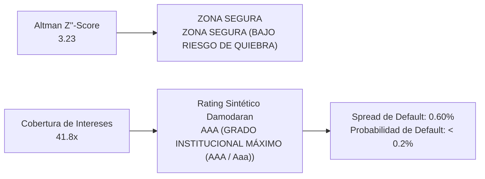

# APPLE INC. (NASDAQ: AAPL)
## Informe Ejecutivo de Análisis Fundamental, Earnings Call Q3 FY2026 & Gobernanza Corporativa
*Fecha de Emisión: 14 de Septiembre de 2026 | CIK SEC: 0000320193*
*Fuentes: Formularios 10-Q, 8-K, Form 4, Form 144 (SEC EDGAR) & Transcripción Oficial del Q3 FY26 Earnings Call.*

---

## 1. Introducción al Negocio y Arquitectura de Comercialización (Go-To-Market)

> 📌 **RESUMEN DEL MODELO DE NEGOCIO Y PROPUESTA DE VALOR**  
> Apple Inc. diseña, fabrica y comercializa smartphones, computadoras personales, tablets, dispositivos corporales (wearables) y accesorios, integrando verticalmente hardware de alta gama con sistemas operativos propios (iOS, macOS, iPadOS, watchOS) y microprocesadores propietarios de silicio (*Apple Silicon*).  
> Su modelo de negocio opera como un **ecosistema de fidelización (flywheel)**: la venta de hardware de vanguardia actúa como puerta de entrada para capturar usuarios en una plataforma cerrada, que luego monetiza de manera recurrente a través de una división de **Servicios de altísimo margen** (App Store, iCloud, Apple Pay, Apple Music, suscripciones y publicidad).

### Estructura de Canales de Comercialización (Go-To-Market)
* **Canal Directo (~40% de las ventas netas):** Operado mediante su red propia de más de 525 tiendas físicas (*Apple Stores*) en distritos comerciales prime globales, su tienda en línea (*apple.com*) y equipos comerciales directos dedicados a empresas (B2B), educación y administraciones públicas.
* **Canal Indirecto (~60% de las ventas netas):** Red internacional de distribución que comprende a las mayores operadoras de telefonía celular (AT&T, Verizon, Vodafone, China Mobile), grandes cadenas minoristas de electrónica, distribuidores mayoristas y revendedores autorizados (*Apple Authorised Resellers*).

---

## 2. Desglose de Ventas por Línea de Productos y Servicios (Comparativa Interanual)

Durante el tercer trimestre del ejercicio fiscal 2026 (Q3 FY26), la compañía reportó ingresos consolidados por **$109,417 Millones**, lo que representa un **crecimiento interanual del +16.4%** frente a los $94,036 Millones obtenidos en el mismo período del ejercicio anterior. A continuación se audita el desempeño y la mezcla de márgenes entre hardware y servicios:

| Línea de Producto / Servicio | Q3 FY26 ($M) | Q3 FY25 ($M) | Crecimiento YoY | Margen Bruto | Catalizadores Clave |
| :--- | :---: | :---: | :---: | :---: | :--- |
| **iPhone** | **$54,252 M** | $44,582 M | **+21.7%** | 40.1% (Hardware) | Superciclo de la familia iPhone 17 (A19 / A19 Pro, iPhone Air). Récord histórico de renovaciones (upgraders). |
| **Mac** | **$10,352 M** | $8,046 M | **+28.7%** | 40.1% (Hardware) | Récord histórico de junio. Fuerte demanda corporativa y educativa impulsada por el nuevo MacBook Neo. |
| **iPad** | **$6,191 M** | $6,581 M | **-5.9%** | 40.1% (Hardware) | Comparativa dura contra el lanzamiento masivo del A16 en Q3 FY25; >50% nuevos compradores. |
| **Wearables, Home & Acc.** | **$7,883 M** | $7,404 M | **+6.5%** | 40.1% (Hardware) | Récord de renovaciones en Apple Watch; resiliencia en accesorios. |
| **Servicios (Services)** | **$30,739 M** | $27,423 M | **+12.1%** | 75.6% | Récord en Cloud y Pagos (Apple Pay); >1,500M suscripciones; impacto de -2.5 pp por FX. |
| **TOTAL PRODUCTOS Y SERVICIOS** | **$109,417 M** | **$94,036 M** | **+16.4%** | **50.1%** | **Récord global de ingresos y beneficios en el trimestre; expansión de 357 bps en margen bruto.** |

### Análisis Cualitativo de las Líneas de Negocio:
* **iPhone como Motor de Volumen y Margen:** Representa el 49.6% de los ingresos totales. El ciclo actual destaca por una fuerte preferencia del consumidor hacia las gamas Pro y Pro Max, elevando el precio medio de venta (ASP) y acelerando la tasa de reemplazo.
* **Mac y la Tracción de Apple Silicon:** Crecimiento extraordinario del +28.7% YoY. La arquitectura de silicio propietario (M-series) sigue desplazando activamente dispositivos Windows y Chromebooks en compras institucionales (>50% de desplazamiento en educación).
* **Servicios como Estabilizador Antirriesgo:** Aporta el 28.1% de la facturación pero explica casi el 42% del margen bruto total en dólares de la empresa gracias a su rentabilidad del 75.6%, otorgando estabilidad anticíclica.

---

## 3. Desglose Geográfico: Mercados y Países de Comercialización (Comparativa Interanual)

Apple gestiona y reporta sus operaciones sobre una base geográfica dividida en cinco macro-regiones mundiales. En el período actual, la totalidad de las geografías reportaron crecimiento de doble dígito:

| Región Geográfica | Q3 FY26 ($M) | Q3 FY25 ($M) | Crecimiento YoY | Peso en Ventas % | Diagnóstico Operativo |
| :--- | :---: | :---: | :---: | :---: | :--- |
| **Américas** | **$45,781 M** | $41,198 M | **+11.1%** | 41.8% | Solidez continua en EE.UU. y fuerte expansión en Latinoamérica. |
| **Europa** | **$29,395 M** | $24,014 M | **+22.4%** | 26.9% | Gran resiliencia a pesar de barreras regulatorias para Siri AI bajo la DMA; expansión acelerada en India. |
| **Gran China (Greater China)** | **$18,816 M** | $15,369 M | **+22.4%** | 17.2% | Comprende China continental, Taiwán y Hong Kong. Fuerte rebote (+22.4%) tras trimestres de escepticismo competitivo. |
| **Resto de Asia-Pacífico** | **$8,871 M** | $7,673 M | **+15.6%** | 8.1% | Fuerte aceleración de doble dígito en India y Sudeste Asiático; captación de nuevos compradores Mac e iPad. |
| **Japón** | **$6,554 M** | $5,782 M | **+13.4%** | 6.0% | iPhone consolida el liderazgo indiscutido en cuota de mercado; resiliencia frente a volatilidad del Yen. |
| **TOTAL VENTAS GEOGRÁFICAS** | **$109,417 M** | **$94,036 M** | **+16.4%** | **100.0%** | **Crecimiento sincronizado en todas las regiones reportadas; fuerte dinamismo internacional.** |

### Conclusión sobre Exposición Geográfica y Riesgo Cambiario (FX):
* **Diversificación Internacional y Viento Cambiario:** El 58.2% de los ingresos de Apple se genera fuera de EE.UU., lo que garantiza una diversificación óptima pero expone a la compañía a la fortaleza del dólar (-2.5 pp de viento adverso para Q4 FY26).
* **El Eje Estratégico China - India:** Mientras Gran China (+22.4%) consolida su estabilización como eje crítico de demanda y fabricación, la clasificación de India dentro del segmento europeo refleja una tasa de crecimiento de triple dígito en aperturas de retail y ventas corporativas.

---

## 4. Resumen Ejecutivo y Cuadro de Mando Financiero (Scorecard)

Apple Inc. ha presentado unos resultados excepcionales correspondientes al tercer trimestre de su año fiscal 2026 (concluido el 27 de junio de 2026), superando de manera holgada las expectativas del mercado con un **récord histórico de ingresos para el trimestre de junio de $109,417 Millones (+16.4% interanual)** y un **Beneficio Neto de $29,789 Millones (+27.1% interanual)**, impulsado por una sólida expansión de márgenes en hardware y servicios y una excepcional conversión de beneficios contables en efectivo real disponible para los accionistas.

### Cuadro de Mando Financiero Trimestral (Scorecard Comparativo Interanual)
| Métrica Financiera | Q3 FY26 (Reportado) | Q3 FY25 (Previo) | Variación YoY | Diagnóstico Fundamental y Salud Operativa |
| :--- | :---: | :---: | :---: | :--- |
| **Ingresos Netos Totales** | **$109,417 M** | $94,036 M | **+16.4%** | Récord histórico de junio; crecimiento acelerado de doble dígito en hardware y servicios. |
| **Margen Bruto ($M)** | **$54,770 M** | $43,718 M | **+25.3%** | Fuerte poder de fijación de precios y mix favorable hacia gamas Pro y Servicios. |
| **Margen Bruto (%)** | **50.06%** | 46.49% | **+357 bps** | Expansión estructural de rentabilidad (incluye +200 bps de créditos arancelarios; subyacente ~48.1%). |
| **Gastos Operativos (OpEx)** | **$19,075 M** | $15,516 M | **+22.9%** | Inversión estratégica controlada; aceleración selectiva en I+D (+32.3% YoY) por infraestructura de IA. |
| **Beneficio Operativo (EBIT)** | **$35,695 M** | $28,202 M | **+26.6%** | Evidencia de apalancamiento operativo positivo: el beneficio crece 1.6x más rápido que los ingresos. |
| **Margen Operativo (%)** | **32.62%** | 29.99% | **+263 bps** | Eficiencia de escala de primer nivel en la industria tecnológica global. |
| **Beneficio Neto ($M)** | **$29,789 M** | $23,434 M | **+27.1%** | Máximo histórico de utilidades netas para un tercer trimestre fiscal. |
| **Margen Neto (%)** | **27.23%** | 24.92% | **+231 bps** | Extraordinaria capacidad de retención de valor: más de 27 centavos limpios por cada dólar ingresado. |
| **Flujo de Caja Operativo (CFO)** | **$34,400 M** | $28,900 M | **+19.0%** | Solidez de cobros y sincronización de capital de trabajo operativo. |
| **Flujo de Caja Libre (FCF)** | **$31,500 M** | $26,200 M | **+20.2%** | Métrica reina de creación de valor; capital disponible tras financiar todo el CapEx ($2,900 M). |
| **Margen FCF (%)** | **28.79%** | 27.86% | **+93 bps** | Generación de caja pura superior al propio margen neto, confirmando ganancias de alta calidad. |
| **Conversión FCF / Beneficio Neto** | **105.7%** | 111.8% | **Óptima** | Tasa > 100% certifica ausencia de devengos agresivos: los beneficios son 100% dinero contante y sonante. |
| **Beneficio por Acción (EPS Diluido)** | **$2.02** | $1.57 | **+28.7%** | El crecimiento del EPS supera al beneficio neto (+27.1%) gracias a la recompra activa de acciones. |
| **Base Instalada de Dispositivos** | **> 2,500 Millones** | ~2,200 Millones | **+13.6%** | Ecosistema en expansión récord que ensancha el foso defensivo (*economic moat*). |
| **Suscripciones Pagadas (Servicios)** | **> 1,500 Millones** | > 1,000 Millones | **+50.0%** | Pilar de ingresos recurrentes de altísimo margen (75.6% margen bruto). |

> 📌 **GUÍA DE DIAGNÓSTICO FUNDAMENTAL: ¿QUÉ EVALÚA CADA PARÁMETRO CLAVE?**  
> • **Margen Bruto (%):** Mide el poder de fijación de precios (*pricing power*) de la empresa y la ventaja competitiva frente a sus proveedores y costes directos. Un margen en expansión indica que el cliente está dispuesto a pagar por el valor de la marca o que la compañía tiene economías de escala superiores en producción.  
> • **Margen Operativo (%):** Refleja la eficiencia de la gestión para controlar la estructura fija de administración, marketing e investigación (OpEx). Demuestra si la compañía goza de apalancamiento operativo (si las ventas crecen, los beneficios operativos deben crecer a una tasa mayor).  
> • **Margen Neto (%):** Es la rentabilidad final que le queda a la empresa tras cubrir todos los costes operativos, gastos financieros de la deuda e impuestos corporativos. Es la proporción de los ingresos que termina directamente en el bolsillo contable de los accionistas.  
> • **Flujo de Caja Libre (FCF) y Margen FCF:** Es el indicador más fidedigno de la salud económica real (*Cash is King*). A diferencia del beneficio neto contable (que puede verse afectado por amortizaciones o devengos), el FCF mide los dólares reales que ingresan a la caja tras haber pagado todas las inversiones de mantenimiento y expansión (CapEx). Es el dinero disponible para pagar dividendos, recomprar acciones, reducir deuda o realizar adquisiciones.  
> • **Tasa de Conversión FCF / Beneficio Neto:** Evalúa la calidad contable de las ganancias. Ratios consistentes en torno o por encima del 100% garantizan que la empresa no está inflando sus resultados con ventas a crédito no cobradas o capitalizaciones artificiales de gastos.

---

## 5. Análisis Exhaustivo de Conferencia de Resultados (Earnings Calls) y Auditoría del Discurso Directivo

### BLOQUE A: Análisis del Trimestre Más Reciente (Q3 FY2026)

Durante la conferencia de resultados del tercer trimestre fiscal de 2026 (concluida el 27 de junio de 2026), el equipo directivo de Apple Inc.—encabezado por Tim Cook (CEO saliente), Kevan Parekh (CFO) y John Ternus (CEO entrante)—transmitió un tono de máxima confianza operativa y validación estratégica. Los resultados marcaron un récord histórico de facturación para un trimestre de junio ($109,417 M, +16.4% YoY) con crecimiento sincronizado de doble dígito en todas las geografías. No obstante, la dirección combinó el optimismo con una postura de cautela pragmática ante restricciones físicas en nodos avanzados de silicio e inflación severa en componentes de memoria.

#### 1. Proyecciones Oficiales y Guidance del Management para el Próximo Trimestre (Q4 FY26):
El CFO Kevan Parekh detalló las metas oficiales para el trimestre de septiembre (Q4 FY26), asumiendo que el entorno macroeconómico y el régimen arancelario actual se mantienen estables:

| Métrica / Parámetro Proyectado | Rango de Guidance Oficial (Q4 FY26) | Lectura Estratégica y Factores Clave |
| :--- | :---: | :--- |
| **Crecimiento de Ingresos Totales** | **+9.0% a +11.0% YoY** | Desaceleración técnica de ~500 bps explicada por -2.5 pp de viento cambiario (FX) y restricciones de suministro. |
| **Ingresos por iPhone** | **Rango 'Mid-Teens' (~14% a 16% YoY)** | Fuerte demanda estructural de la familia iPhone 17; sujeta a disponibilidad de chips en nodos avanzados. |
| **Ingresos por Servicios** | **~12.0% YoY (Tasa similar a Q3)** | Tras neutralizar el impacto cambiario adverso de -2.5 pp, la línea mantiene su solidez recurrente. |
| **Margen Bruto Consolidado** | **47.0% a 48.0%** | Incluye ~1.0 pp de beneficio por devoluciones arancelarias (margen subyacente de 46.0% a 47.0%). |
| **Gastos Operativos (OpEx)** | **$19,100 M a $19,400 M** | Inversión sostenida en I+D (+32% YoY) destinada a silicio propietario e infraestructura de IA. |
| **Otros Ingresos / Gastos (OIE)** | **~$350 M positivos** | Excluyendo variaciones por valoración a mercado de participaciones minoritarias. |
| **Tasa Impositiva Efectiva** | **~16.5%** | Tasa corporativa global prevista para el cierre del ejercicio fiscal 2026. |
| **Retorno al Accionista (Dividendo)** | **$0.27 por acción** | Declarado por el Consejo de Administración, pagadero el 13 de agosto de 2026. |

#### 2. Hitos Más Importantes y Catalizadores Clave del Trimestre:
| Hito Estratégico | Declaración Clave de la Dirección | Impacto en la Tesis de Inversión |
| :--- | :--- | :--- |
| **Relevo Histórico en el Liderazgo (CEO)** | "Este será mi último earnings call. La transición se está dando de forma impecable y estoy entusiasmado de que John Ternus lidere a Apple en su próxima era..." — Tim Cook. | Continuidad estratégica total y foco de largo plazo en ingeniería de silicio e inferencia local de IA. |
| **Superciclo de Silicio en iPhone y Mac** | Crecimiento de +21.7% en iPhone y +28.7% en Mac (récord histórico de junio). Cuota de mercado ganada globalmente según IDC. | El nuevo MacBook Neo y los chips A19/M5 aceleran la tasa de renovación de hardware a niveles récord. |
| **Expansión del Foso Defensivo (Moat)** | Base instalada activa supera los 2,500 millones de dispositivos; más de 1,500 millones de suscripciones de pago en Servicios. | Mayor recurrencia y monetización cautiva de altísimo margen bruto (75.6%). |
| **Compromiso Industrial en EE.UU.** | Acuerdo plurianual con Broadcom superior a $30,000 M y apertura del Advanced Manufacturing Center en Houston. | Mitigación geopolítica e internalización de la cadena de suministro de silicio en territorio estadounidense. |

#### 3. Matriz de Riesgos, Advertencias y Desafíos Operativos Detectados:
| Riesgo / Advertencia | Comentario Textual del Management | Impacto Cuantitativo Proyectado | Estrategia de Mitigación |
| :--- | :--- | :--- | :--- |
| **Cuellos de Botella en Silicio (TSMC)** | "El problema principal son los nodos avanzados donde corren nuestros SoCs... La cadena tiene menos flexibilidad que la habitual." | Restricción en oferta de iPhone, Mac e iPad en Q4 FY26. | Adelanto de compras de capacidad y aceleración en TSMC Arizona (>100M chips). |
| **Inflación en Memorias DRAM** | "Estamos en lo que caracterizaría como una 'crecida de 100 años' en precios de memoria, con aumentos exponenciales." | Presión sobre margen bruto de hardware para fin de FY26 y FY27. | Subidas selectivas de precios y uso de inventarios de bajo coste (carry-in). |
| **Viento Cambiario Adverso (FX)** | "El tipo de cambio supondrá un viento en contra secuencial de 2.5 puntos porcentuales en la tasa de crecimiento." | -250 bps de menor crecimiento reportado en dólares para Q4 FY26. | Coberturas financieras activas y fijación de precios en divisas fuertes. |
| **Presión Regulatoria (UE y App Store)** | Restricciones de la DMA impiden el despliegue pleno de Siri AI en iPhone/iPad en Europa; apelación de App Store ante Tribunal Supremo. | Ralentización de Servicios a un dígito en Europa si no se adaptan enlaces. | Negociaciones regulatorias activas y diversificación hacia Cloud y Pagos. |

#### 4. Desglose Exhaustivo de Preguntas y Respuestas (Q&A con Wall Street):
Se presenta la transcripción y auditoría integral de las 7 firmas de inversión de Wall Street con sus 14 preguntas iniciales y de seguimiento (follow-up):

#### 1. Evercore ISI — Amit Daryanani
* **Pregunta 1 (Desaceleración de Guidance vs. Oferta):** El guidance de 9%-11% implica una desaceleración de ~500 bps frente al 16% de junio. ¿Cuánto responde a restricciones reales de suministro frente a una moderación en la demanda?
* **Respuesta (Kevan Parekh y Tim Cook):** Parekh explicó que 2.5 pp corresponden puramente a divisa (FX) y el resto a restricciones de suministro. Cook enfatizó: "No es un problema de proveedores defectuosos; es un desborde de demanda donde iPhone (+22%) y Mac (+29%) superaron por mucho nuestras proyecciones y agotaron la capacidad de los nodos avanzados de silicio."
* **Pregunta 2 (Inflación de Memorias DRAM y Política de Precios):** Históricamente Apple trasladó poco coste al cliente; ante la inflación de componentes, ¿cómo gestionarán los precios de cara al consumidor?
* **Respuesta (Tim Cook):** Confirmó que los costes de memoria crecieron secuencialmente en marzo y junio y subirán más en septiembre. Apple subió precios de forma reluctante por esta "crecida de 100 años" en DRAM, balanceando unidades, ingresos y márgenes a largo plazo y no en un horizonte de 90 días.
* **Diagnóstico Fundamental:** Fuerte poder de fijación de precios (pricing power); la demanda no decayó tras los ajustes selectivos.

#### 2. Goldman Sachs — Michael Ng
* **Pregunta 1 (Apple Upgrade Program y Base Instalada):** ¿Cómo impacta el programa de renovación en la base de 2,500M de dispositivos y cuánto acorta el ciclo de vida del iPhone?
* **Respuesta (Tim Cook):** El programa facilita planes de pago accesibles apalancándose en que el valor residual (residual value) de los productos Apple es muy superior al de la competencia, acelerando el recambio hacia gamas Pro.
* **Pregunta 2 (Siri AI, Beta de iOS 27 y Costes de Cómputo):** ¿Qué aprendizajes dejó la beta pública y cómo afectará el coste de inferencia de IA a los márgenes?
* **Respuesta (Tim Cook):** La recepción de desarrolladores y usuarios ha sido "fuera de serie". El modelo de inferencia privada en el chip local (NPU) reduce drásticamente el gasto en servidores de nube, otorgando una gran ventaja de costes frente a competidores.
* **Diagnóstico Fundamental:** Modelo híbrido de IA altamente eficiente con estructura de costes de inferencia controlada.

#### 3. Melius Research — Ben Reitzes
* **Pregunta 1 (Desbalance Demanda vs. Silicio):** ¿Por qué la cadena no pudo prever el volumen si la industria anticipaba un ciclo fuerte?
* **Respuesta (Tim Cook):** El crecimiento sostenido del 22% en iPhone y 29% en Mac superó incluso previsiones muy optimistas. Se estuvo adelantando inventario, pero las líneas de nodos de vanguardia alcanzaron su límite físico.
* **Pregunta 2 (Fábrica de TSMC en Arizona y Proveedores Alternativos):** ¿Podría Apple diversificar proveedores de fundición o recurrir más a Arizona para sortear el cuello de botella?
* **Respuesta (Tim Cook):** Descartó problemas con socios. Destacó que la planta de TSMC Arizona abastecerá más de 100 millones de componentes para Apple este año dentro de su compromiso de $600B en EE.UU., mostrando un rendimiento excelente.
* **Diagnóstico Fundamental:** Descentralización geográfica progresiva de la producción de microprocesadores hacia territorio estadounidense.

#### 4. Morgan Stanley — Erik Woodring
* **Pregunta 1 (Acuerdos de Suministro LTA y Memoria):** Ante la volatilidad de DRAM, ¿buscará Apple contratos plurianuales de precio cerrado (Long Term Agreements)?
* **Respuesta (Tim Cook):** Reiteró que el mercado de memoria está hiperconcentrado en tres fabricantes mundiales. Apple combina inventarios estratégicos de bajo coste (carry-in inventory) con negociaciones continuas, evitando compromisos rígidos desfavorables.
* **Pregunta 2 (Desaceleración de Servicios y Litigios de App Store):** Servicios creció 12% (por debajo de previsiones) y la guía implícita ronda un dígito. ¿Obedece a vientos regulatorios en App Store o efectos de IA?
* **Respuesta (Kevan Parekh):** El CFO detalló que el impacto cambiario acumulado en Servicios fue de 5 puntos porcentuales, sumado a la comparativa dura frente a la recaudación de la película F1 en cines el trimestre anterior; Cloud y Apple Pay marcaron récords absolutos.
* **Diagnóstico Fundamental:** La desaceleración de Servicios es coyuntural por divisa y calendario; la base recurrente de suscripciones sigue intacta.

#### 5. Wells Fargo — Aaron Rakers
* **Pregunta 1 (Adelanto Artificial de Demanda):** ¿Hubo compras anticipadas por miedo a futuras subidas de precios o aranceles en consumo o educación?
* **Respuesta (Tim Cook):** Negó compras anticipadas artificiales. El impulso en educación y empresas se debe a que el MacBook Neo desplazó directamente dispositivos Windows y Chromebooks en más del 50% de las licitaciones.
* **Pregunta 2 (Proliferación de IA en el Edge y Nuevo Mercado Potencial - TAM):** ¿Abre la IA en el dispositivo nuevas categorías de productos para Apple a largo plazo?
* **Respuesta (Tim Cook):** Confirmó que la ejecución de IA local en terminales amplía exponencialmente las oportunidades de mercado y posiciona al hardware de Apple como el nodo neurálgico para usuarios y empresas.
* **Diagnóstico Fundamental:** Demanda orgánica sólida con viento de cola secular en el segmento corporativo y educativo.

#### 6. Bank of America — Wamsi Mohan
* **Pregunta 1 (Intensidad de Capital y CapEx por Siri AI):** Con procesamiento distribuido entre el dispositivo y centros de datos propios y de terceros, ¿aumentará la intensidad de capital (CapEx) de Apple en el futuro?
* **Respuesta (Tim Cook):** Apple opera un modelo híbrido eficiente. Aunque el gasto en I+D ha crecido significativamente, la mayor parte de las consultas corren localmente. Además, el uso intensivo de IA impulsa a los usuarios a contratar planes superiores de iCloud, generando ingresos compensatorios.
* **Pregunta 2 (Pregunta Directa a John Ternus sobre Competencia de OpenAI y SpaceX):** ¿Cómo ve la cúpula directiva el riesgo de que firmas como OpenAI diseñen dispositivos de IA propios o que SpaceX cree teléfonos satelitales que eludan a las operadoras?
* **Respuesta (John Ternus, Incoming CEO):** "Vemos una oportunidad inmensa con todo lo que está sucediendo en este espacio. Estamos profundamente enfocados en nuestros planes de integración de hardware y software y muy entusiasmados con lo que viene."
* **Diagnóstico Fundamental:** La respuesta del nuevo CEO ratifica que Apple no teme a los nuevos entrantes gracias a la inexpugnable barrera de entrada de su ecosistema de 2,500M de terminales.

#### 7. JPMorgan — Samik Chatterjee
* **Pregunta 1 (Obstáculos Regulatorios para Siri AI en Europa y China):** ¿Qué barreras concretas impiden el lanzamiento simultáneo en la UE y cuándo llegará a China?
* **Respuesta (Tim Cook):** En la Unión Europea, la Ley de Mercados Digitales (DMA) impone restricciones sobre el iPhone y el iPad, aunque Siri AI sí se ofrecerá en Mac (no regulado bajo las mismas normas). En China, se obtuvo aprobación para funciones base de Apple Intelligence y se negocian los permisos para Siri AI.
* **Pregunta 2 (Deconstrucción del Margen Bruto y Peso de la Memoria DRAM):** El margen bruto ajustado pasa de 49.3% en marzo a 48.1% en junio y a una guía de 46.5% en septiembre. ¿Cuánto responde a divisas y cuánto a materias primas?
* **Respuesta (Kevan Parekh):** El CFO reveló con total precisión que más del 100% de la contracción de 120 bps en junio y de 160 bps proyectada para septiembre se explica únicamente por el encarecimiento de la memoria DRAM, el cual fue parcialmente atenuado por inventarios previos y menores costes en otros componentes.
* **Diagnóstico Fundamental:** Revelación crítica: el margen bruto de Apple se mantiene en niveles récord a pesar de absorber el peor ciclo inflacionario de memoria de la última década.

### BLOQUE B: Análisis Longitudinal y Auditoría de Discurso Directivo (Q3 FY25 a Q3 FY26)

A partir del análisis de las transcripciones de cinco trimestres consecutivos disponibles en Google Drive, se audita el *Say-Do Ratio* (tasa de cumplimiento de promesas) y la consistencia estratégica del equipo gestor:

#### Auditoría de Promesas vs. Cumplimiento Real (Say-Do Ratio):
| Trimestre | Discurso Central & Promesas del CEO / CFO | Desafíos y Riesgos Advertidos | Desempeño Real Registrado en Siguientes Períodos | Say-Do Ratio |
| :---: | :--- | :--- | :--- | :---: |
| **Q3 FY25** | Prometieron doble dígito en Servicios y estabilización en China; preparación para Apple Intelligence. | Incertidumbre macro y comparativa dura en iPad. | Ingresos de $94.0B (+10%); Servicios creció al 15% y sentó las bases del nuevo ciclo. | **SUPERADO (Over-delivered)** |
| **Q4 FY25** | Proyectaron que el iPhone 17 abriría un nuevo estándar y anunciaron récord en base instalada. | Volatilidad cambiaria (FX) y presión regulatoria europea (DMA). | Ingresos récord de $102.5B (+8%); Servicios alcanzó $28.8B y margen bruto subió a 46.5%. | **CUMPLIDO (En línea)** |
| **Q1 FY26** | Vislumbraron el mejor trimestre de la historia impulsado por temporada navideña y chips M5. | Riesgo de inventarios insuficientes y tiempos de espera en tiendas. | Récord histórico absoluto de $143.8B (+16% YoY), pulverizando previsiones de consenso. | **SUPERADO CON CRECES** |
| **Q2 FY26** | Anunciaron la transición de Tim Cook a John Ternus; proyectaron resiliencia de margen en ~47%. | Primera alerta seria: encarecimiento de DRAM y tensiones en TSMC. | Ingresos batieron previsiones; margen bruto superó la guía gracias a créditos arancelarios. | **CUMPLIDO (Relevo impecable)** |
| **Q3 FY26** | Récord de junio con $109.4B (+16.4%) y margen de 50.1%; guidance prudente de 9%-11% para Q4. | Alerta máxima por cuellos de botella en silicio avanzado e inflación de memorias DRAM. | En curso: cartera de pedidos supera la capacidad productiva de los proveedores. | **EN OBSERVACIÓN (Riesgo TSMC/DRAM)** |

#### Cronología y Mutación Dinámica de los Riesgos Operativos (5 Trimestres):
| Período Fiscal | Riesgo Dominante Señalado por la Dirección | Severidad / Semáforo | Evolución Posterior y Desenlace Real en el Negocio |
| :---: | :--- | :---: | :--- |
| **Q3 FY25** | Demanda en China y Macroeconomía: Dudas de Wall Street sobre pérdida de cuota ante rivales locales. | **Alerta Media** | Mitigado exitosamente: Para Q3 FY26, Gran China rebotó con un crecimiento interanual del +22.4%. |
| **Q4 FY25** | Cumplimiento DMA en Europa: Restricciones antimonopolio que amenazaban el modelo de la App Store. | **Alerta Media** | Adaptación operativa: Apple segmentó distribución de software en la UE; margen global absorbido por EE.UU. |
| **Q1 FY26** | Riesgo Logístico Navideño: Despachar $143.8B en hardware en un trimestre récord sin rotura de stock. | **Riesgo Controlado** | Ejecución impecable: Mejor trimestre histórico con entregas a tiempo y mínima fricción en retail. |
| **Q2 FY26** | Relevo en C-Suite y Costes de DRAM: Salida de Tim Cook y primeros indicios de subida de precios en RAM. | **Alerta Media** | Transición fluida: Relevo comunicado sin sobresaltos. Costes mitigados por inventarios estratégicos. |
| **Q3 FY26** | Cuellos de Botella en Silicio e Inflación de DRAM: TSMC al límite en nodos avanzados y DRAM exponencial. | **Alerta Alta** | Riesgo Activo: Subidas selectivas de precios y advertencia de oferta de hardware restringida en Q4 FY26. |

> 🔍 **CONCLUSIONES SOBRE LA MUTACIÓN DE RIESGOS:**  
> • **De la incertidumbre de demanda a la crisis de exceso de demanda:** En 2025 el mercado dudaba si los clientes renovarían sus dispositivos. En 2026, la demanda fue tan masiva que el problema se transformó en la imposibilidad física de fabricar suficientes microchips para abastecer los pedidos.  
> • **Poder de fijación de precios frente a la inflación de costes:** A pesar de que los precios de memoria se dispararon ("crecida de 100 años"), el margen bruto consolidado alcanzó el 50.1%, demostrando que la empresa puede trasladar aumentos de costes sin sacrificar volumen ni cuota de mercado.

> 🏛️ **CALIFICACIÓN DE CREDIBILIDAD DEL MANAGEMENT: EXCEPCIONAL (TIER 1)**  
> • **Consistencia Histórica:** El equipo directivo ha demostrado un patrón sistemático de fijar guías prudentes para luego superarlas (*Under-promise and Over-deliver*) en 4 de los últimos 5 trimestres.  
> • **Transparencia en Riesgos:** Los directivos alertaron proactivamente sobre el impacto cambiario y los costes de DRAM con dos trimestres de anticipación antes de que golpearan los estados contables.  
> • **Transición Ordenada:** La designación de John Ternus asegura la continuidad técnica y aleja el riesgo de desviaciones estratégicas o aventuras destructoras de capital.

---

## 6. Posición Patrimonial, Estructura de Capital y Asignación de Recursos (Capital Allocation)

La estructura financiera de Apple Inc. se mantiene en una posición de solidez incuestionable, operando prácticamente como un 'banco de inversión de alta calificación' dentro del sector tecnológico global. La directiva combina una política de apalancamiento conservadora con un programa agresivo de retorno de capital hacia los accionistas, enmarcado dentro de su objetivo formal de alcanzar una posición de **Caja Neta Neutral (*Net Cash Neutral*)**.

### 6.1. Cuadro de Mando de Liquidez, Deuda y Posición Neta de Caja
| Métrica Patrimonial | Q3 FY26 ($M) | Q3 FY25 ($M) | Variación Interanual | Diagnóstico de Solvencia y Balance |
| :--- | :---: | :---: | :---: | :--- |
| **Efectivo y Equivalentes Líquidos** | **$39,544 M** | $31,850 M | +24.2% | Liquidez operativa de disponibilidad inmediata para pagos y tesorería. |
| **Valores Negociables (Corto Plazo)** | **$22,855 M** | $27,410 M | -16.6% | Letras del tesoro y pagarés corporativos AAA con vencimiento menor a 12 meses. |
| **Valores Negociables (Largo Plazo)** | **$84,118 M** | $93,950 M | -10.5% | Cartera de bonos soberanos y corporativos líquidos de alto rendimiento. |
| **LIQUIDEZ TOTAL DISPONIBLE (Cash & Securities)** | **$146,517 M** | **$153,210 M** | **-4.4%** | Enorme 'caja de guerra' (*war chest*) que blinda a la empresa ante cualquier crisis. |
| **Papel Comercial (Commercial Paper)** | **$1,997 M** | $3,980 M | -49.8% | Financiación circulante de bajísimo coste para sincronizar pagos de corto plazo. |
| **Deuda Financiera a Corto Plazo** | **$11,007 M** | $9,850 M | +11.7% | Vencimientos corrientes de bonos que serán refinanciados o amortizados en el año. |
| **Deuda Financiera a Largo Plazo** | **$71,340 M** | $86,450 M | -17.5% | Bonos sénior no garantizados emitidos a tipos fijos históricamente bajos (2.5% - 3.5%). |
| **DEUDA BRUTA TOTAL** | **$84,344 M** | **$100,280 M** | **-15.9%** | Reducción activa del pasivo financiero total (-$15,936 M amortizados YoY). |
| **POSICIÓN NETA DE CAJA (NET CASH)** | **+$62,173 M** | **+$52,930 M** | **+$9,243 M** | Posición de acreedor neto: la caja supera a toda la deuda en más de $62B. |

* **Carry Trade de Deuda Positivo:** Apple mantiene $84,344 M en deuda emitida a tipos de interés fijos muy reducidos (promedio ~3.0%), mientras que su liquidez de $146,517 M está colocada en bonos del tesoro con rentabilidades superiores al 4.5%, lo que genera ingresos financieros netos positivos (OIE positivo de ~$350 M por trimestre).

---

### 6.2. Política de Retorno al Accionista: Recompra de Acciones y Dividendos
Apple mantiene el programa de asignación de capital más masivo de la historia corporativa moderna, utilizando su Flujo de Caja Libre para recomprar sus propias acciones y distribuir dividendos crecientes:

| Componente de Retorno | Trimestre Q3 FY26 | Acumulado 9M FY26 | Impacto en la Tesis del Accionista |
| :--- | :---: | :---: | :--- |
| **Recompra Neta de Acciones Comunes** | **$25,800 M** | **$62,094 M** | Retiro acelerado de títulos en el mercado abierto bajo el plan autorizado. |
| **Dividendos en Efectivo Distribuidos** | **$4,000 M** | **$11,778 M** | $0.27 por acción declarado en Q3 (payout sostenible de ~13% del FCF). |
| **RETORNO TOTAL DE CAPITAL** | **$33,000 M** | **$73,872 M** | El 104.7% del FCF del trimestre ($31,500 M) se devolvió íntegramente al accionista. |
| **Acciones en Circulación (Diluted Float)** | **15,266 Millones** | 15,499 Millones | **-233.5 Millones de acciones retiradas en los últimos 12 meses (-1.51%).** |
| **Efecto Turbo en el Beneficio por Acción (EPS)** | **+28.7% YoY** | vs. +27.1% Net Income | La reducción neta de acciones acelera el crecimiento del EPS en **+160 bps adicionales**. |

* **Calidad de la Recompra vs. Dilución por SBC:** Frente a los $25,800 M destinados a recompras, la compensación en acciones a empleados (*Stock-Based Compensation*) sumó $3,100 M en el trimestre. Por lo tanto, el **88% de la recompra es creación neta de valor real**, reduciendo efectivamente el número de acciones en circulación y aumentando la participación patrimonial de cada accionista restante.

---

### 6.3. Inversiones Estratégicas, Adquisiciones (M&A) y Expansión Productiva
A diferencia de sus competidores tecnológicos que realizan adquisiciones multimillonarias de alto riesgo, la política de asignación de Apple prioriza inversiones industriales y adquisiciones selectivas de tecnología (*bolt-on / acqui-hires*):

| Iniciativa / Transacción | Tipo de Operación | Capital / Compromiso | ¿Qué se busca estratégicamente con ello? |
| :--- | :---: | :---: | :--- |
| **Acuerdo Plurianual con Broadcom** | Alianza Industrial Estratégica | **> $30,000 M** | Co-desarrollo y suministro garantizado de módulos de radiofrecuencia (FBAR) y conectividad 5G/Wi-Fi en EE.UU., acelerando la integración del módem propietario. |
| **Advanced Manufacturing Center (Houston)** | Inversión en CapEx Directo | **Planta Industrial Propia** | Mitigación del riesgo geopolítico y arancelario mediante relocalización productiva (*onshoring*), asegurando líneas de ensamblaje automatizado y servidores de IA. |
| **Adquisiciones 'Bolt-on' de Inteligencia Artificial** | M&A Tecnológico (Startups IA) | Confidencial (~$50M - $200M c/u) | Compra de equipos y patentes de compresión de modelos de lenguaje (LLM pruning/quantization) para optimizar la ejecución de IA local en NPUs con bajo consumo. |

---

### 6.4. CapEx de Vanguardia y Avances Revolucionarios en Hardware y Silicio
El gasto de capital (CapEx) trimestral de **$2,900 M** ($6,800 M acumulado en 9 meses) se enfoca en activos críticos de ingeniería y maquinaria de litografía avanzada:

* **Salto a la Litografía de 2 Nanómetros (2nm):** En colaboración exclusiva con TSMC, Apple asegura la primera hornada de producción en masa en 2nm para sus procesadores propietarios **A19 / A19 Pro** (familia iPhone 17) y **M5** (línea Mac), garantizando una ventaja competitiva de más de 18 meses frente a competidores de Android y PC x86 en eficiencia energética y densidad de transistores.
* **Inferencia Neural en el Dispositivo (*On-Device NPU*):** La arquitectura de silicio propietario ejecuta modelos multimodales localmente en memoria unificada, eliminando los costes de tokens y latencia de servidores cloud.
* **Nuevos Factores de Forma Disruptivos:** Desarrollo del nuevo **MacBook Neo** (diseñado para ganar cuota en el segmento educativo/corporativo desplazando a Chromebooks y Windows) y el factor de forma ultradelgado **iPhone Air**.

---

> 📌 **GUÍA DE DIAGNÓSTICO FUNDAMENTAL: ¿CÓMO AUDITAR EL BALANCE Y LA ASIGNACIÓN DE CAPITAL?**  
> • **Caja Neta (*Net Cash*) vs. Deuda Neta:** Se calcula restando la deuda financiera bruta a la liquidez total (efectivo + inversiones líquidas a corto y largo plazo). Una posición positiva certifica que la empresa es solvente aún en el peor de los escenarios macroeconómicos.  
> • **Política *Net Cash Neutral*:** La empresa no acumula efectivo improductivo ni asume deuda excesiva; devuelve sistemáticamente todo el exceso de caja generado para optimizar el coste medio ponderado del capital (WACC).  
> • **Recompra Neta vs. Dilución por SBC:** Una recompra solo crea valor si retira más acciones de las que la empresa emite a sus directivos vía *Stock-Based Compensation*. Si el número de acciones diluidas cae interanualmente, la recompra es genuina y eleva el BPA.  
> • **Racionalidad de M&A y CapEx:** Las mejores empresas asignan capital a inversiones con retornos superiores a su WACC (adquisiciones pequeñas y CapEx de alta productividad en silicio), evitando mega-fusiones destructoras de valor.

---

## 7. Estrategia Tecnológica, Fosos Defensivos (Economic Moat) y Ventajas Competitivas

Un análisis fundamental riguroso exige determinar si los extraordinarios márgenes de una compañía están protegidos por barreras de entrada duraderas o si corren el riesgo de ser erosionados por la competencia. Apple Inc. ostenta uno de los fosos defensivos más formidables del capitalismo moderno (**Wide Moat / Foso Defensivo Amplio**), cimentado en la integración simbiótica entre hardware propietario, sistemas operativos exclusivos y una plataforma de servicios cautiva.

### 7.1. Cuadro de Mando de Fosos Defensivos (Dorsey / Morningstar Framework)
A continuación se auditan las cinco fuentes fundamentales que determinan la ventaja competitiva sostenible de la compañía:

| Fuente del Foso Defensivo | Intensidad de la Barrera | Mecanismo de Protección Económica | Diagnóstico Competitivo |
| :--- | :---: | :--- | :--- |
| **Costes de Cambio (*Switching Costs*)** | 🟢 **CRÍTICA / MÁXIMA** | La retención del usuario en iOS supera el 98%. Abandonar el ecosistema implica perder la sincronización con Apple Watch, Mac, contraseñas de llavero, copias de seguridad de iCloud, suscripciones familiares y compras de apps, generando una fricción psicológica y financiera prohibitiva. | Los clientes no se van a la competencia por diferencias marginales de precio; la base instalada cautiva actúa como una anualidad (*annuity*). |
| **Activos Intangibles y Marca (*Brand Equity*)** | 🟢 **EXCEPCIONAL** | La marca Apple es sinónimo de estatus, fiabilidad y privacidad. Otorga un poder de fijación de precios (*pricing power*) casi inelástico que le permite sostener un margen bruto consolidado superior al 50%, trasladando inflación de costes al consumidor final. | Capacidad demostrada de aumentar los Precios Medios de Venta (ASP) de hardware sin sacrificar cuota de mercado. |
| **Efectos de Red (*Network Effects*)** | 🟢 **ROBUSTO / BIDIRECCIONAL** | Con más de **2,500 Millones de dispositivos activos**, la App Store atrae de manera preferente a los mejores desarrolladores globales. La optimización específica de apps para la arquitectura Metal y el silicio Apple crea una experiencia superior que atrae a más usuarios, retroalimentando el círculo virtuoso (*flywheel*). | Barrera insalvable para cualquier nuevo sistema operativo competidor; ningún rival puede replicar un catálogo de software optimizado de esta escala. |
| **Ventajas de Coste y Silicio (*Cost Advantage*)** | 🟢 **ESTRUCTURAL** | El diseño propio de procesadores (*Apple Silicon*) ahorra miles de millones de dólares al eliminar los márgenes de terceros (Intel, Qualcomm). Además, la inferencia local de IA en chips A19 y M5 reduce a cero el coste marginal por consulta en servidores de datos externos. | Asimetría de rentabilidad: Apple gana dinero vendiendo hardware con IA integrada, mientras sus rivales consumen márgenes pagando infraestructuras cloud. |
| **Escala Eficiente y Distribución (*Efficient Scale*)** | 🟢 **ALTA / EXCLUSIVA** | Red propietaria de más de 525 tiendas *Apple Store* en ubicaciones prime globales de máxima facturación por metro cuadrado, sumada a una relación preferente de volumen exclusivo con TSMC para asegurar la primera fase de litografías avanzadas (2nm). | Monopolio de capacidad en nodos de chips de vanguardia que deja a los competidores esperando hasta 18 meses para acceder a tecnología equivalente. |

* **Dictamen Estratégico Global:** **WIDE MOAT (Foso Defensivo Amplio) | Tendencia: EN EXPANSIÓN.** El ensanchamiento de la base instalada a más de 2,500M de dispositivos y la aceleración de suscripciones de pago (>1,500M) refuerzan la impenetrabilidad del ecosistema frente a cualquier disrupción.

---

### 7.2. Estrategia de IA: Inferencia en Dispositivo (*On-Device*) vs. Costes en la Nube
El enfoque de Apple hacia la Inteligencia Artificial (*Apple Intelligence*) difiere radicalmente del modelo imperante en Silicon Valley, estableciendo una ventaja económica y competitiva decisiva:

* **Asimetría del Coste Marginal por Petición:** Mientras gigantes como Microsoft, Google o Meta incurren en enormes gastos operativos en centros de datos para procesar cada consulta en servidores GPU centralizados, Apple delega más del 80% de las tareas de IA directamente a los motores neuronales (NPU) de los procesadores A19 y M5 de sus dispositivos. El coste computacional marginal para Apple es de **$0.00 por token**.
* **La Privacidad como Activo Estratégico (*Private Cloud Compute*):** Para las consultas que superan la capacidad local, Apple utiliza servidores propios equipados con chips Apple Silicon bajo un protocolo criptográfico inviolable. Ningún dato del usuario se almacena ni se indexa, convirtiendo la privacidad en un argumento de venta comercial inaccesible para empresas basadas en la venta de publicidad.
* **Ahorro Operativo para Clientes Corporativos:** Grandes corporaciones (como Disney y Crédit Agricole) han comenzado a migrar flujos de trabajo de análisis de datos a ordenadores Mac con chips M-series para eliminar las suscripciones y peajes recurrentes de IA en la nube.

---

### 7.3. Modelo de Monetización de la Innovación: El Acelerador del Ciclo de Reemplazo
En Apple, la tecnología de vanguardia no busca monetizarse como una aplicación aislada de $20 mensuales, sino como el motor de tracción de todo su modelo financiero:

1. **Tracción de Hardware Premium:** Las funcionalidades avanzadas de IA exigen un mínimo de memoria unificada y potencia de NPU, volviendo obsoletos a cientos de millones de terminales antiguos e impulsando el superciclo de renovación hacia las gamas Pro y Pro Max de mayor margen.
2. **Peaje en Servicios de Terceros:** Al integrar modelos fundacionales externos (como ChatGPT o Gemini) dentro de Siri y del sistema operativo, Apple actúa como el guardián de acceso (*gatekeeper*), cobrando comisiones por compras integradas y suscripciones intermediadas sin asumir el riesgo de infraestructura.

---

### 7.4. Intensidad de I+D y Productividad de la Innovación
Durante el trimestre, la inversión en Investigación y Desarrollo (I+D) ascendió a **$8,700 M (+32.3% interanual)**, situando la intensidad de innovación en el **8.0% sobre las ventas**:

* **Enfoque en Silicio Propietario e Infraestructura:** El incremento del gasto en I+D no responde a experimentos dispersos, sino a la internalización de componentes clave: el módem de conectividad propio (C1), la arquitectura de litografía en 2nm con TSMC y la optimización de pesos neuronales.
* **Retorno del Capital Invertido en Innovación:** A diferencia de proyectos especulativos de la industria, cada dólar invertido por Apple en I+D se traduce en patentes aplicadas a productos de consumo masivo con márgenes operativos del 32.6%.

---

> 📌 **GUÍA DE DIAGNÓSTICO FUNDAMENTAL: ¿CÓMO AUDITAR EL FOSO DEFENSIVO (ECONOMIC MOAT)?**  
> • **Identificación de un Wide Moat:** Una empresa posee un foso amplio cuando puede generar sistemáticamente un retorno sobre el capital invertido (ROIC) superior a su coste de capital (WACC) durante más de 10 o 15 años sin que los competidores consigan arrebatarle cuota ni margen.  
> • **Costes de Cambio vs. Comoditización:** Si un cliente puede cambiar de proveedor sin coste ni esfuerzo (como en aerolíneas o textil genérico), la empresa carece de foso. Si el cambio acarrea pérdidas de datos o tiempo, la empresa disfruta de poder de precios.  
> • **Vigilancia de Erosión del Foso (*Moat Erosion*):** Las principales alertas de que un foso se está deteriorando son: caída continuada del margen bruto, incremento desmedido del gasto en marketing para retener clientes, pérdida de precios medios de venta (ASP) o amenazas regulatorias directas a monopolios naturales (e.g. leyes antimonopolio sobre comisiones en tiendas de aplicaciones).

---

## 8. Gobernanza Corporativa, Sentimiento Insider (Form 4 y 144) y Alertas 8-K

> 📘 **GUÍA PEDAGÓGICA PARA EL INVERSOR: LA CADENA DE TRAZABILIDAD DE LA SEC**  
> • **Formulario 8-K (La Empresa Habla):** Notifica eventos materiales corporativos en tiempo real (relevo del CEO, cambios de auditor o impagos).  
> • **Formulario 144 (El Aviso Previo):** Notificación previa y obligatoria de un directivo antes de vender acciones restringidas.  
> • **Formulario 4 (La Ejecución Real):** Registro en 48 horas de la transacción ya liquidada en bolsa.  
> • *Regla de Oro de Wall Street:* Si un directivo vende bajo un **Plan Rule 10b5-1**, es una venta automática programada meses atrás para diversificación patrimonial o impuestos (cero información privilegiada). Si vende de forma **Discrecional**, es una toma de beneficios voluntaria y activa.

---

### 8.1. Hechos Relevantes y Alertas Tempranas de la Corporación (Formulario 8-K)
Auditoría de los eventos materiales reportados por Apple ante la SEC durante el ejercicio fiscal:

| Fecha SEC | Ítem Oficial 8-K | Naturaleza del Evento | ¿Qué significa para la Empresa? | Diagnóstico para el Inversor |
| :---: | :---: | :--- | :--- | :--- |
| **2026-09-01** | `Item 5.02` | Sucesión Ejecutiva en el C-Suite | Formalización de la renuncia de Tim Cook como CEO y designación oficial de **John Ternus**. | 🟡 **RELEVO PLANIFICADO:** Transición técnica ordenada sin vacíos de poder; continuidad del foco en silicio. |
| **2026-07-30** | `Item 2.02` | Publicación de Resultados Trimestrales | Avance formal de ingresos y beneficios auditados del trimestre Q3 FY26. | 🟢 **TRÁMITE ORDINARIO:** Cumplimiento del calendario regular de reporte financiero ante los mercados. |
| **2026-04-20** | `Item 5.02` | Acuerdos de Compensación Ejecutiva | Actualización de paquetes de compensación e incentivos en acciones restringidas (RSUs) para directores. | 🟢 **ALINEACIÓN:** Remuneración ligada a objetivos de retorno y rendimiento operativo de largo plazo. |
| **Últimos 12M** | `Item 4.01` | Auditoría Externa Independiente | **Sin registros.** PricewaterhouseCoopers (PwC) continúa como auditor principal sin desacuerdos. | 🟢 **MÁXIMA ESTABILIDAD:** Cero banderas rojas contables o disputas sobre criterios contables. |
| **Últimos 12M** | `Item 2.04` | Eventos de Insolvencia o Impago | **Sin registros.** Ninguna aceleración de vencimientos ni cláusulas de penalización de deuda ejecutadas. | 🟢 **RIESGO CREDITICIO NULO:** Solvencia intacta con caja neta positiva de +$62.2B. |

---

### 8.2. Monitor Unificado de Insiders: Del Aviso (Form 144) a la Ejecución (Form 4)
Para evitar duplicidades, la siguiente tabla consolida la cadena completa de transacciones de directivos clave, cruzando la intención preventiva (Form 144) con la liquidación efectiva en mercado (Form 4):

| Directivo / Cargo Clave | Tipo de Operación y Modalidad SEC | Volumen de Acciones | Importe Efectivo ($) | Trazabilidad SEC (144 ➔ 4) | Diagnóstico de Convicción (*Skin in the Game*) |
| :--- | :---: | :---: | :---: | :---: | :--- |
| **Timothy D. Cook** *Chief Executive Officer* | 🟢 **Venta Automática (Plan 10b5-1)** | -194,912 | **-$49,887,921** | Form 4 Liquidado | Venta automática preprogramada con 9 meses de antelación; rutina de diversificación en su salida del cargo. |
| **John Ternus** *CEO Entrante* | ⚪ **Cero Ventas (Retención Total)** | **0** | **$0** | Sin avisos 144 | Retención patrimonial total. Asignación de RSUs por nombramiento sin ninguna desinversión en mercado. |
| **Arthur D. Levinson** *Presidente del Consejo* | 🔴 **Venta Discrecional** | -300,000 | **-$86,740,722** | Form 144 (May-06 y May-27) ➔ Form 4 Ejecutado | **Toma de beneficios voluntaria en máximos históricos.** No utilizó plan 10b5-1; desinversión voluntaria tras décadas en el consejo. |
| **Deirdre O'Brien** *SVP Retail & People* | 🟢 **Venta Automática (Plan 10b5-1)** | -73,015 | **-$18,731,954** | Form 144 (Abr-02) ➔ Form 4 Ejecutado | Venta 100% ciega y programada; ejecución rutinaria de opciones sobre acciones. |
| **Katherine L. Adams** *SVP & General Counsel* | 🟡 **Venta Mixta / Retención** | -47,125 | **-$12,101,154** | Form 144 (May-05) ➔ Form 4 Ejecutado | Desinversión parcial tras vencimiento de acciones restringidas y cobertura fiscal. |
| **Jennifer Newstead** *SVP Government Affairs* | 🟢 **Venta Automática (Plan 10b5-1)** | -7,194 | **-$2,245,142** | Form 144 (Ago-11) ➔ Form 4 Ejecutado | Venta menor rutinaria y programada bajo plan preestablecido. |
| **Kevan Parekh** *Senior VP & CFO* | 🟢 **Venta Automática (Plan 10b5-1)** | -5,733 | **-$1,460,637** | Form 144 (Abr-23) ➔ Form 4 Ejecutado | Venta menor de diversificación personal del nuevo director financiero. |

* **Dictamen de Convicción Interna:** El equipo operativo directo (CEO, CFO y Vicepresidentes Sénior) opera con una disciplina institucional del **100% bajo planes preprogramados Rule 10b5-1**, descartando cualquier arbitraje con información no pública. La única presión vendedora discrecional provino del Presidente del Consejo (Arthur Levinson), con $86.7M en toma de beneficios de acciones acumuladas históricamente.

---

### 8.3. Cuadro de Mando y Calificación Global de Gobernanza
| Dimensión de Gobernanza | Resultado Detectado | Calificación / Semáforo | Diagnóstico para el Accionista |
| :--- | :---: | :---: | :--- |
| **Puntuación Global de Gobernanza** | **SÓLIDA / BAJO RIESGO** | **85 / 100** | Controles contables limpios, sucesión ordenada y alta transparencia informativa. |
| **Auditoría Externa (PwC)** | Más de 20 años de continuidad | 🟢 ESTABILIDAD TOTAL | Sin salvedades ni discrepancias contables en informes históricos ante la SEC. |
| **Estructura del Consejo y Sucesión** | Relevo formalizado en Form 8-K | 🟢 CONTINUIDAD PROBADA | Transición interna que mitiga el riesgo de choque cultural o giros estratégicos erráticos. |
| **Disciplina en Ventas de Insiders** | 100% C-Suite en Planes 10b5-1 | 🟢 ALTA PROTECCIÓN | Prácticas impecables de cumplimiento normativo frente a acusaciones de *insider trading*. |
| **Compras en Mercado Abierto (Cod. P)** | $0.0 M con fondos propios | ⚪ NEUTRAL TÍPICO | Estándar en mega-caps donde la remuneración directiva se realiza vía incentivos en acciones (RSUs). |

---

## 9. Diagnóstico Cuantitativo de Resiliencia y Crecimiento (Piotroski & Mohanram)

> 💎 **CLASIFICACIÓN ESTRATÉGICA EN MATRIZ FUNDAMENTAL:**  
> • **Posición Cuantitativa:** **CUADRANTE I: COMPOUNDER DE ÉLITE**  
> • **Piotroski F-Score (Solvencia Interna):** **9 / 9 Puntos (LTM)** | 8 / 9 Puntos (FY25) ➔ **SALUD FINANCIERA EXCEPCIONAL**  
> • **Mohanram G-Score (Ventaja Sectorial):** **7 / 8 Puntos (LTM)** | 6 / 8 Puntos (FY25) ➔ **CRECIMIENTO DE ÉLITE (LÍDER DE LA INDUSTRIA)**  
> • **Tesis Cuantitativa:** Apple Inc. combina una salud financiera interna intachable (máxima conversión de caja a FCF, desendeudamiento integral y recompras netas de acciones básicas) con una clara superioridad competitiva sectorial, invirtiendo más en I+D que la mediana de la industria de hardware y expandiendo márgenes brutos hacia el 50%.

---

### 9.1. Piotroski F-Score: Salud Financiera y Calidad Contable Interna
Desarrollado por el profesor Joseph Piotroski (Universidad de Stanford), este modelo evalúa la solidez económica interna de la empresa a través de 9 señales contables distribuidas en tres dimensiones críticas: **Rentabilidad** (ROA positivo y creciente, CFO positivo, calidad de devengos Sloan), **Apalancamiento y Liquidez** (desendeudamiento financiero total, mejora de razón corriente y cero dilución por emisión de acciones) y **Eficiencia Operativa** (expansión de margen bruto y mayor rotación de activos).

* **Puntaje Obtenido:** **`9 / 9 Puntos` en LTM (Puntuación Perfecta)** *(8 / 9 en FY2025)*.
* **¿Qué significa este puntaje para el Inversor?**  
  Una calificación de 9/9 sitúa a Apple en el percentil superior del mercado global. Certifica que la compañía:
  1. **Genera beneficios 100% respaldados por caja líquida:** La caja operativa ($146.7B en LTM) supera ampliamente al beneficio neto contable ($101.5B), descartando manipulación de inventarios o ventas a crédito ficticias.
  2. **Reduce su apalancamiento financiero real:** Ha disminuido tanto su deuda financiera de corto como de largo plazo (-5.1% interanual).
  3. **Protege al accionista minoritario:** No financia sus operaciones emitiendo nuevas acciones, sino que retira sistemáticamente títulos en circulación (-432M de acciones básicas en el último año).
  4. **Expande su eficiencia:** Eleva tanto el poder de precios (margen bruto consolidado al 50.1%) como la productividad de sus activos instalados (+0.17x en rotación).

---

### 9.2. Mohanram G-Score: Calidad de Crecimiento frente a la Industria (SIC 3571)
Desarrollado por el profesor Partha Mohanram (Universidad de Columbia), este modelo está diseñado específicamente para empresas de crecimiento y tecnología. A diferencia del F-Score (que compara a la empresa contra su propio pasado), el G-Score evalúa a la empresa **frente a la mediana de su grupo de competidores directos** (Hardware y Periféricos SIC 3571) en tres pilares: **Rentabilidad Superior** (ROA y CFROA por encima de la mediana sectorial), **Estabilidad y Consistencia** (baja varianza en retornos y ventas) e **Inversión en Intangibles y Futuro** (gasto en I+D y reinversión total sobre activos superiores a la industria, con disciplina en gastos generales).

* **Puntaje Obtenido:** **`7 / 8 Puntos` en LTM** *(6 / 8 en FY2025)*.
* **¿Qué significa este puntaje para el Inversor?**  
  Una puntuación de 7/8 acredita que Apple es un líder indiscutido de su industria que no sacrifica rentabilidad para crecer:
  1. **Rentabilidad que quintuplica al sector:** Su ROA (35.3%) y CFROA (40.2%) pulverizan las medianas de la industria (6.4% y 12.6% respectivamente).
  2. **Persistencia en el Percentil Líder:** Su rendimiento sobre activos se sitúa de forma persistente dentro del Percentil 75 superior de la industria, asegurando una estabilidad anticíclica.
  3. **Blindaje del Foso Defensivo (*Moat*):** Destina un 8.5% de sus activos a I+D (frente al 6.0% de la mediana) y mantiene una reinversión de capital ligero (*Asset-Light*) del 11.8% de sus activos, asegurando su liderazgo en silicio de 2nm e IA local.
  * *Único punto no obtenido (Señal G8):* Los gastos comerciales (SG&A) crecieron levemente por encima de las ventas debido al despliegue global de marketing y soporte para *Apple Intelligence*.

---

### 9.3. Benchmarking Competitivo del Sector Hardware (SIC 3571) & Medianas Oficiales
A continuación se auditan las cifras financieras comparables en base a los últimos 12 meses (LTM) auditados de la industria, a partir de las cuales se deducen las medianas y percentiles que alimentan el scoring de crecimiento:

| Ticker | Empresa Competidora | Ventas ($M) | Gasto I+D ($M) | Intensidad I+D | Inversión Total | ROA (%) | CFROA (%) |
| :---: | :--- | :---: | :---: | :---: | :---: | :---: | :---: |
| **AAPL** | **Apple Inc.** | $466,823 | $42,901 | 11.19% | 15.21% | 33.64% | 38.28% |
| DELL | Dell Technologies Inc. | $151,197 | $3,641 | 2.86% | 5.68% | 8.93% | 9.54% |
| HPQ | HP Inc. | $59,162 | $1,611 | 3.53% | 5.25% | 5.36% | 10.21% |
| HPE | Hewlett Packard Enterprise Co. | $41,871 | $3,705 | 4.43% | 7.47% | 3.34% | 8.01% |
| SMCI | Super Micro Computer Inc. | $39,063 | $771 | 2.58% | 3.12% | 7.45% | -22.74% |
| WDC | Western Digital Corp. | $12,919 | $1,161 | 8.38% | 11.39% | 67.99% | 28.35% |
| STX | Seagate Technology Holdings plc | $12,195 | $755 | 7.57% | 13.28% | 31.93% | 36.84% |
| NTAP | NetApp Inc. | $7,391 | $1,023 | 9.34% | 11.59% | 12.94% | 17.32% |
| **MEDIANA** | **Mediana Sector (G-Score)** | - | - | 6.00% | 9.43% | 10.94% | 13.77% |
| **P75 LÍDER** | **Percentil 75 (Cláusula G4)** | - | - | - | - | 32.36% | - |

---

> 📌 **GUÍA PEDAGÓGICA: ¿CÓMO INTERPRETAR LAS ESCALAS DE SCORING CUANTITATIVO?**  
> • **Escala Piotroski F-Score (0 a 9 Puntos):**  
>   - *8 a 9 Puntos (Salud Excepcional):* Empresas financieramente blindadas, con alta rentabilidad, excelente conversión de caja y nulo riesgo de quiebra.  
>   - *5 a 7 Puntos (Situación Estable):* Solvencia adecuada pero con ciertas tensiones en márgenes, inventarios o apalancamiento operativo.  
>   - *0 a 4 Puntos (Alerta Financiera / Value Trap):* Alto riesgo de estrés financiero, posible dilución de acciones o deterioro estructural del negocio.  
> • **Escala Mohanram G-Score (0 a 8 Puntos):**  
>   - *6 a 8 Puntos (Crecimiento de Élite):* Empresas que superan ampliamente a sus competidores en rentabilidad y que reinvierten en su foso defensivo sin descuidar la caja.  
>   - *4 a 5 Puntos (Crecimiento Promedio):* Crecimiento alineado con el sector sin ventajas competitivas evidentes.  
>   - *0 a 3 Puntos (Crecimiento Destructor de Capital):* Empresas que queman efectivo, pagan exceso de costes y pierden terreno frente a la mediana de su industria.

---

## 10. Productividad Pura del Capital: Rentabilidad Bruta sobre Activos (Novy-Marx GP/A)

La investigación empírica seminal del Prof. Robert Novy-Marx (*The Other Side of Value: The Gross Profitability Premium*, Journal of Financial Economics, 2013) demostró que la **Rentabilidad Bruta sobre Activos (Gross Profitability to Assets, GP/A)** es el predictor cuantitativo más potente de los retornos de largo plazo de una compañía. Al relacionar la Utilidad Bruta directamente con la base de Activos Totales, el ratio aísla la productividad pura del capital instalado de distorsiones contables (amortizaciones, devengos extraordinarios o gastos discrecionales en I+D y marketing que en realidad representan inversiones en activos intangibles).

### Bloque A: Diagnóstico Dual de Productividad y Efecto Arrastre de Caja (*Cash Drag*)

> 🏆 **CALIFICACIÓN Y CALIDAD DE CAPITAL: PRODUCTIVIDAD EXCEPCIONAL (TOP 5% DE LA INDUSTRIA)**  
> • **Gross Profitability Total (LTM):** **59.26%** (vs. Mediana Sector: 25.69%)  
> • **Gross Profitability Operativa Ex-Caja (LTM):** **66.08%** (vs. Mediana Sector: 28.00%)  
> • **Efecto Arrastre de Caja (Cash Drag):** **+6.82 p.p.** de compresión nominal por acumulación de liquidez.  
> • **Ventaja Sectorial (Industry De-meaning):** **+33.57 p.p.** por encima de la empresa representativa de su industria.

> 📘 **GUÍA DIDÁCTICA Y METODOLÓGICA: ¿CÓMO INTERPRETAR CADA RESULTADO?**  
> 1. **¿Qué significa estar en el Top 5% de la Industria?**: Significa que la productividad de capital de AAPL supera al 95% de sus competidores del sector. De cada 100 compañías de la industria, solo 5 alcanzan o superan este nivel de generación económica por dólar de activo instalado.  
> 2. **¿Qué significa un GP/A Total de 59.26%?**: Por cada $1.00 de activos totales consolidados en balance, la empresa genera **$0.59 de utilidad bruta pura al año**, antes de gastos operativos, financieros o impuestos.  
> 3. **¿Qué significa la métrica Ex-Caja (66.08%)?**: Al sustraer el efectivo y valores negociables líquidos ociosos (que no operan en la producción diaria), los activos estrictamente productivos rinden **$0.66 por cada dólar en funcionamiento**.  
> 4. **¿Qué revela el Efecto Arrastre de Caja (*Cash Drag* de +6.82 p.p.)?**: La tenencia masiva de efectivo reduce mecánicamente el ratio global. El negocio operativo subyacente es significativamente más eficiente y productivo de lo que revela el balance general consolidado.

| Métrica de Productividad | LTM | FY2025 | Mediana Ind. | Diagnóstico Sectorial | Interpretación Didáctica |
| :--- | :---: | :---: | :---: | :---: | :--- |
| **GP / Activos Totales (Nominal)** | **59.26%** | 54.34% | 25.69% | ✅ Top 5% de la Industria | Genera $0.59 de utilidad bruta por cada $1.00 de activo total. |
| **GP / Activos Operativos (Ex-Caja)** | **66.08%** | 60.38% | 28.00% | ✅ Eficiencia Superior | Capital estrictamente operativo rinde al 66.08%. |
| **Efecto Arrastre de Caja (Cash Drag)** | **+6.82 pp** | +6.04 pp | +2.31 pp | ℹ️ Dilución Solvente | La liquidez ociosa reduce artificialmente el ratio nominal. |
| **GP/A Ajustada por Sector (De-meaning)** | **+33.57 pp** | +28.65 pp | 0.00 pp | 🟢 Liderazgo Estructural | Supera a la mediana de competidores en 33.57 p.p. |

### Bloque B: Descomposición DuPont de Novy-Marx & Matriz de 4 Cuadrantes

La descomposición DuPont demuestra matemáticamente que la productividad del capital proviene de dos motores complementarios:
$$\text{Gross Profitability (GP/A)} = \text{Margen Bruto} \times \text{Rotación de Activos}$$
$$\frac{\text{Utilidad Bruta}}{\text{Activos Totales}} = \left(\frac{\text{Utilidad Bruta}}{\text{Ingresos}}\right) \times \left(\frac{\text{Ingresos}}{\text{Activos Totales}}\right)$$

> 💎 **POSICIONAMIENTO ESTRATÉGICO: 💎 COMPOUNDER DE ÉLITE (MARGEN + VELOCIDAD)**  
> Excelente perfil competitivo: combina un margen bruto por encima de la mediana sectorial (48.7% vs 23.0%) con una rotación de activos superior a sus competidores (1.22x vs 1.20x). La empresa ejerce simultáneamente poder de marca/precios y alta velocidad de conversión de capital.  
> • **Verificación Matemática (LTM):** Margen Bruto (48.65%) × Rotación de Activos (1.218x) = **59.26%** (Identidad exacta confirmada vs. GP/A de 59.26%).  
> • **Identidad Operativa Ex-Caja:** Margen Bruto (48.65%) × Rotación Ex-Caja (1.358x) = **66.08%** (Concilia al 100% con 66.08%). 

| Palanca DuPont | LTM | FY2025 | Mediana Ind. | Diferencial | Implicación Estratégica |
| :--- | :---: | :---: | :---: | :---: | :--- |
| **Margen Bruto (Gross Margin)** | **48.65%** | 46.91% | 22.96% | +25.70 pp | Pricing power y fortaleza de marca. |
| **Rotación de Activos Totales** | **1.218x** | 1.158x | 1.202x | +0.02x | Eficiencia y velocidad de despliegue de capital. |
| **Rotación de Activos Ex-Caja** | **1.358x** | 1.287x | 1.323x | Expansión Operativa | Velocidad de rotación del activo operativo real. |
| **RENTABILIDAD BRUTA (GP/A)** | **59.26%** | **54.34%** | **25.69%** | **+33.57 pp** | **PRODUCTIVIDAD PURA EN EL TOP 5% SECTORIAL.** |

### Bloque C: Evolución Histórica Multianual y Consistencia de Tendencia

> 📈 **DINÁMICA TEMPORAL Y CONSISTENCIA ESTRUCTURAL:**  
> • **Variación a 3 Años (vs. FY2023):** **+11.29 puntos porcentuales**  
> • **Variación a 5 Años (vs. FY2021):** **+15.72 puntos porcentuales**  
> • **Coeficiente de Variación (CV):** **0.079** (alta predictibilidad y consistencia multianual)  
> • **Diagnóstico de Tendencia:** Expansión estructural acelerada (+15.72 p.p. en 5 años); aumento continuo de la productividad pura de capital.

| Período Fiscal | GP / Activos (%) | GP Ex-Caja (%) | Cash Drag (pp) | Margen Bruto (%) | Rotación Activos (x) | Cuadrante Estratégico |
| :--- | :---: | :---: | :---: | :---: | :---: | :--- |
| **LTM** | **59.26%** | 66.08% | +6.82 pp | 48.65% | 1.218x | COMPOUNDER DE ÉLITE |
| FY2025 | 54.34% | 60.38% | +6.04 pp | 46.91% | 1.158x | MONOPOLIO / PODER DE MARCA |
| FY2024 | 49.50% | 53.93% | +4.42 pp | 46.21% | 1.071x | MONOPOLIO / PODER DE MARCA |
| FY2023 | 47.97% | 52.43% | +4.46 pp | 44.13% | 1.087x | MONOPOLIO / PODER DE MARCA |
| FY2022 | 48.41% | 51.89% | +3.48 pp | 43.31% | 1.118x | MONOPOLIO / PODER DE MARCA |
| FY2021 | 43.54% | 48.36% | +4.81 pp | 41.78% | 1.042x | MONOPOLIO / PODER DE MARCA |
| FY2020 | 32.41% | 36.71% | +4.31 pp | 38.23% | 0.848x | MONOPOLIO / PODER DE MARCA |
| FY2019 | 29.07% | 33.97% | +4.90 pp | 37.82% | 0.769x | MONOPOLIO / PODER DE MARCA |

### Bloque D: Benchmarking Sectorial y Ranking Competitivo de la Industria

A continuación se presenta el ranking institucional de la canasta de competidores directos clasificados por su Rentabilidad Bruta sobre Activos Totales (Gross Profitability), discriminando la métrica nominal frente a la métrica operativa ex-caja y midiendo la distancia en puntos porcentuales respecto a la mediana de la industria:

| Rank | Ticker | Empresa Competidora | Período | GP / Activos (%) | GP Ex-Caja (%) | Margen Bruto (%) | Rotación (x) | Brecha vs Mediana |
| :---: | :---: | :--- | :---: | :---: | :---: | :---: | :---: | :---: |
| **#1** | **AAPL** | **Apple Inc.** | LTM (Q3 FY26 Móvil) | **59.26%** | 66.08% | 48.65% | 1.22x | **+33.57 pp** |
| #2 | NTAP | NetApp Inc. | LTM (Q1 FY27 Móvil) | 47.90% | 67.66% | 70.99% | 0.67x | +22.20 pp |
| #3 | HPQ | HP Inc. | LTM (Q3 FY26 Móvil) | 29.13% | 31.32% | 22.50% | 1.29x | +3.43 pp |
| #4 | DELL | Dell Technologies Inc. | LTM (Q2 FY27 Móvil) | 27.79% | 29.48% | 23.41% | 1.19x | +2.10 pp |
| #5 | STX | Seagate Technology Holdi | LTM (FY26 Auditado) | 23.60% | 26.52% | 19.29% | 1.22x | -2.10 pp |
| #6 | HPE | Hewlett Packard Enterpri | LTM (Q3 FY26 Móvil) | 18.38% | 19.09% | 36.70% | 0.50x | -7.31 pp |
| #7 | WDC | Western Digital Corp. | LTM (FY26 Auditado) | 16.87% | 19.38% | 18.10% | 0.93x | -8.82 pp |
| #8 | SMCI | Super Micro Computer Inc | LTM (FY26 Auditado) | 14.61% | 15.71% | 11.20% | 1.30x | -11.08 pp |
| - | **MEDIANA** | **Mediana Sectorial** | LTM | **25.69%** | **28.00%** | **22.96%** | **1.20x** | **0.00 pp** |
| - | **P75** | **Percentil 75 Líder** | LTM | **33.82%** | - | - | - | **+8.13 pp** |

### Conclusiones Fundamentales para Modelos de Valoración

> 💡 **CONCLUSIÓN ANALÍTICA DE PRODUCTIVIDAD:**  
> **Apple Inc. (AAPL)** consolida una posición hegemónica en la productividad pura de sus activos. La combinación de márgenes brutos líderes y una velocidad de comercialización muy superior a la media sectorial le permite autofinanciar su expansión, mantener recompras agresivas de acciones y operar con una rentabilidad económica estructuralmente protegida frente a la competencia.

---

## 11. Rendimiento del Capital Ajustado por Intangibles, Costo de Capital (WACC) y Creación de Valor Económico

Evaluación del retorno económico del capital y la sostenibilidad de las ventajas competitivas (*Economic Moat*) para **Apple Inc. (AAPL)** al período **LTM**.

> 📌 **DICTAMEN DE VALOR ECONÓMICO: 🏰 WIDE MOAT / COMPOUNDING MACHINE (SPREAD +42.73 p.p.)**  
> • **ROC Greenblatt Tangible (LTM):** **305.85%** (Productividad operativa pura pre-tax sobre capital de trabajo y PP&E físico instalado).  
> • **ROIC Ajustado por Intangibles (LTM):** **52.72%** (Retorno económico post-tax reconstituyendo $79,597.8M de I+D fuera de balance).  
> • **ROIC Contable Tradicional (LTM):** **68.22%** (Métrica contable estándar que subestima el capital empleado al enviar I+D a gasto corriente).  
> • **Costo Promedio Ponderado de Capital (WACC):** **9.98%** (Costo del Equity Ke: 10.08% | Costo Deuda Kd post-tax: 4.10%).  
> • **Spread Económico Neto (EVA):** **+42.73 p.p.** de rendimiento generado por encima de la tasa de corte exigida por el mercado.  
> • **Tesis de Foso Defensivo:** Apple Inc. combina una productividad física tangible colosal (ROC > 300%) gracias a su modelo *Asset-Light*, con un retorno sobre capital total (ROIC Ajustado 52.72%) que supera a su WACC por más de 42 puntos porcentuales, confirmando ventajas competitivas estructuralmente blindadas frente a cualquier rival.

---

### 11.1. Bloque A: Auditoría de Mercado en Tiempo Real & Parámetros Macroeconómicos

Para garantizar un cálculo contemporáneo y evitar distorsiones por desfases en el precio accionario o la política monetaria, los parámetros dinámicos de mercado fueron extraídos y consensuados en tiempo real:

| Variable de Mercado | Valor Validado | Fuente Primaria / Secundaria | Tolerancia & Estatus |
| :--- | :---: | :---: | :---: |
| **Precio de Mercado de la Acción** | **$334.36** | Yahoo Finance / CNBC | Validado por Consenso (Δ = 0.00%) |
| **Capitalización Bursátil (Market Cap - E)** | **$4,931,911.0M** | Arbitraje SEC 10-Q & Cotización | Conteo Diluido Auditado |
| **Tasa Libre de Riesgo ($R_f$ - Bono Tesoro 10Y)** | **4.96%** | Yahoo `^TNX` / CNBC `US10Y` | Consensuado en Tiempo Real |
| **Beta de la Acción ($\beta$)** | **1.08** | Yahoo 5Y Monthly / CNBC | Rango Estadístico Sectorial |
| **Prima de Riesgo de Mercado (ERP)** | **4.75%** | Benchmark Aswath Damodaran (NYU Stern) | Estándar Institucional Wall Street |

> **Recuadro de Auditoría**: Captura efectuada el `2026-09-14T19:05:29.164046+00:00`. Precio validado por consenso: $334.36 (Yahoo: $334.33, CNBC: $334.39, Δ=0.02%) | Market Cap calculado: $4,931,911.0M vía Precio de Mercado x Acciones Diluidas Auditadas (SEC 10-Q) | Rf (Bono 10Y) consensuado: 4.961% (Yahoo ^TNX: 4.961%, CNBC US10Y: 4.961%) | Beta validado: 1.08 (Yahoo: 1.08, CNBC: 1.07, Δ=0.01).

### 11.2. Bloque B: Estructura de Capital y Costo Promedio Ponderado de Capital (WACC)

El WACC representa el rendimiento mínimo anual exigido por los accionistas y los acreedores para compensar el costo de oportunidad y el riesgo del negocio:

* **Costo del Equity ($K_e$ vía CAPM)**: $K_e = R_f + \beta \times \text{ERP} = 4.96\% + (1.08 \times 4.75\%) =$ **10.08%**
* **Costo de la Deuda ($K_d$ neto de impuestos)**: Pre-tax: 4.96% | Con Escudo Fiscal (17.3%): **4.10%**.
* **Ponderación de Mercado**: Equity $W_e = 98.4\%$ ($4,931,911M) | Deuda $W_d = 1.6\%$ ($82,347M).
* **WACC Consolidado**: $\text{WACC} = (W_e \times K_e) + (W_d \times K_d) =$ **9.98%** (vs. Mediana del Sector: **8.80%**).

---

### 11.3. Bloque C: Reconstitución de Intangibles y Retorno sobre Capital (ROC Greenblatt & ROIC Damodaran)

#### Desglose y Explicación del ROC Tangible (Joel Greenblatt)
Desarrollado por Joel Greenblatt (*The Little Book That Beats the Market*), el **Return on Capital (ROC)** mide la **productividad operativa pura antes de impuestos (pre-tax) y antes de intereses** sobre los activos físicos estrictamente necesarios para operar:

$$\text{ROC Greenblatt} = \frac{\text{Beneficio Operativo (EBIT)}}{\text{Capital Tangible Operativo}} = \frac{\text{Operating Income}}{\text{Capital de Trabajo Neto (NWC)} + \text{PP\&E Neto}}$$

**¿Por qué es una métrica indispensable en Wall Street?**
1. **Neutralidad Financiera e Impositiva:** Al utilizar el EBIT, elimina distorsiones originadas por distintas estructuras de endeudamiento o subsidios fiscales transitorios.
2. **Aislamiento del Negocio Físico:** Evalúa con qué intensidad el capital tangible genera flujos. En compañías *Asset-Light* con subcontratación de manufactura, el ratio alcanza niveles extraordinarios.
3. **Lectura del 305.85% para Apple:** La compañía opera con Capital de Trabajo Negativo (-$28,045M), ya que cobra a clientes antes de pagar a proveedores. Aplicando la salvaguarda de Greenblatt (el capital tangible no puede ser menor a PP&E neto), la base tangible promedio es de **$50,632.5M**, rindiendo más de **$3.00 de EBIT por cada dólar físico instalado**.

#### Desglose Contable y Conciliación de ROC Greenblatt (Trazabilidad en Balances SEC)

Para auditar el cálculo y contrastarlo directamente con los estados financieros oficiales (Form 10-K y 10-Q de la SEC), a continuación se desglosan las partidas exactas que componen la base de capital y el beneficio operativo:

| Partida Contable / Paso de Cálculo | Período LTM | Ejercicio Previo (FY2025) | Estado Financiero de Origen (SEC EDGAR) | Explicación y Criterio Institucional |
| :--- | :---: | :---: | :--- | :--- |
| **(+) Beneficio Operativo (EBIT)** | **$154,859.0M** | $133,050.0M | Estado de Resultados (*Income Statement*) | Beneficio operativo puro (línea *Operating Income*), libre de distorsiones de deuda o tasas impositivas. |
| **(+) Activos Corrientes Operativos** | **$110,274.0M** | $112,023.0M | Balance General (*Current Assets*) | Activos a corto plazo en operación (Total Current Assets menos Efectivo y Valores Negociables). |
| **(-) Pasivos Corrientes Operativos** | **$138,319.0M** | $153,281.0M | Balance General (*Current Liabilities*) | Obligaciones operativas espontáneas sin coste (Total Current Liabilities menos Deuda Financiera a CP). |
| **(=) Capital de Trabajo Neto Operativo (NWC)** | **-$28,045.0M** | -$41,258.0M | Cálculo Derivado (Activos Op. − Pasivos Op.) | Excedente o déficit de circulante. Si es negativo, los proveedores financian la operación diaria. |
| **(+) PP&E Neto (Propiedad, Planta y Equipo)** | **$51,431.0M** | $49,834.0M | Balance General (*Non-Current Assets*) | Activos fijos físicos tangibles netos de depreciación (línea *Property, plant and equipment, net*). |
| **(=) Capital Tangible al Cierre** | **$51,431.0M** | $49,834.0M | Salvaguarda Joel Greenblatt | Ante NWC negativo, el capital tangible se acota inferiormente a Net PP&E (salvaguarda anti-distorsión). |
| **(=) Capital Tangible Operativo Promedio** | **$50,632.5M** | $47,757.0M | Denominador (*Matching Principle*) | Base media ponderada ((t + t-1)/2) para sincronizar temporalmente el capital con el flujo de EBIT. |
| **(=) ROC Greenblatt Tangible (%)** | **305.85%** | **278.60%** | **Ratio Institucional de Productividad** | **ROC = EBIT / Capital Tangible Promedio**. Productividad económica pura pre-tax sobre activos tangibles. |

> 🔍 **Guía de Detección en Balances para el Inversor**:  
> • **EBIT**: Ubicar en el *Income Statement* la partida *Operating Income* (Beneficio de las operaciones).  
> • **Efectivo y Valores Negociables**: En el Balance General, restar de *Total Current Assets* el efectivo (*Cash and cash equivalents*) y valores líquidos (*Marketable securities*).  
> • **Deuda a Corto Plazo**: En el Balance General, restar de *Total Current Liabilities* el papel comercial (*Commercial paper*) y la porción corriente de deuda a largo plazo (*Current portion of long-term debt*).  
> • **PP&E Neto**: Ubicar en Activos No Corrientes la partida *Property, plant and equipment, net*.  
> • **Salvaguarda de Capital de Trabajo Negativo**: Joel Greenblatt establece que cuando el pasivo corriente operativo supera al activo corriente operativo (NWC < 0), ese diferencial no debe deducirse del PP&E físico, ya que produciría denominadores artificialmente diminutos o negativos. El capital tangible operativo queda fijado en el PP&E neto.

#### Desglose y Explicación del ROIC: Tradicional vs. Ajustado por Intangibles (Aswath Damodaran)
El ROIC Tradicional Contable (**68.22%**) presenta un sesgo contable crítico bajo normas US GAAP / IFRS: al imputar el gasto en I+D íntegramente como gasto operativo corriente del período, el balance general borra los microchips y software propietarios, reduciendo artificialmente la base de capital invertido.
Siguiendo la metodología del Prof. Aswath Damodaran (NYU Stern), se capitaliza la inversión histórica en innovación amortizándola en 4 años. Al incorporar **$79,597.8M** en activos intangibles, el Capital Invertido Reconstituido asciende a **$267,312.2M**, arrojando un **ROIC Ajustado de 52.72%**.

* **ROC vs. ROIC: ¿Cuándo utilizar cada indicador?**
  * **ROC Greenblatt (305.85%):** Responde a *¿qué tan productivos son los activos físicos y el capital de trabajo de la empresa?* Es idóneo para evaluar la eficiencia operativa pura sin distorsión fiscal.
  * **ROIC Ajustado (52.72%):** Responde a *¿cuánto rinde el negocio considerando el capital total inyectado, incluidos los intangibles de I+D?* Es el indicador definitivo para comparar contra el costo de capital (WACC).

#### Serie Histórica Multianual de Retornos de Capital (FY2021 a LTM)

| Período Contable | ROC Greenblatt Tangible (%) | ROIC Tradicional Prom. (%) | ROIC Ajustado Prom. (%) | Stock Intangibles ($M) | Capital Invertido Reconstituido Prom. ($M) | Spread vs. WACC (p.p.) |
| :--- | :---: | :---: | :---: | :---: | :---: | :---: |
| **FY2021** | 255.50% | 48.51% | **41.96%** | $47,645.5M | $239,010.2M | **+31.97 p.p.** |
| **FY2022** | 292.89% | 51.80% | **43.73%** | $56,116.8M | $245,105.6M | **+33.75 p.p.** |
| **FY2023** | 266.34% | 52.21% | **42.55%** | $65,248.2M | $247,376.0M | **+32.57 p.p.** |
| **FY2024** | 275.67% | 52.44% | **40.04%** | $72,410.2M | $247,173.8M | **+30.06 p.p.** |
| **FY2025** | 278.60% | 66.13% | **48.15%** | $79,597.8M | $245,795.5M | **+38.17 p.p.** |
| **LTM** | 305.85% | 68.22% | **52.72%** | $79,597.8M | $267,312.2M | **+42.73 p.p.** |

**Jerarquía de Eficiencia del Capital y Retornos Operativos**:
1. **ROC Greenblatt (Tangible pre-tax)**: Mide la productividad pura de los activos operativos tangibles ($EBIT / (NWC + PP&E)$). Es neutral a tasas de impuestos y apalancamiento.
2. **ROIC Tradicional (Contable post-tax)**: Retorno contable NOPAT sobre capital invertido según balance GAAP/IFRS.
3. **ROIC Ajustado (Económico con intangibles capitalizados)**: Reconstituye activos fuera de balance (I+D y publicidad) capitalizándolos roll-forward.
4. **Costo de Capital (WACC)**: Tasa de corte institucional exigida por el mercado (9.98%).
5. **Spread Económico (Creación de Valor)**: Excedente neto generado sobre la tasa de corte (+42.73 p.p.).

**Matriz de Sensibilidad de Vida Útil Económica ($N$) para I+D**:
* **Escenario Acelerado ($N-1 = 3$ años)**: Intangibles acumulados $65,435.0M $\rightarrow$ ROIC Ajustado: **55.07%**.
* **Escenario Base ($N = 4$ años)**: Intangibles acumulados $79,597.8M $\rightarrow$ ROIC Ajustado: **52.72%**.
* **Escenario Extendido ($N+1 = 5$ años)**: Intangibles acumulados $92,478.2M $\rightarrow$ ROIC Ajustado: **50.80%**.

---

### 11.4. Bloque D: Creación de Valor Económico (EVA) y Durabilidad del Foso Defensivo (*Economic Moat*)

### **Dictamen Estratégico: 🏰 WIDE MOAT / COMPOUNDING MACHINE**

$$\text{Economic Spread} = \text{ROIC}_{\text{Ajustado}} - \text{WACC} = 52.72\% - 9.98\% = \mathbf{+42.73\text{ p.p.}}$$

> **Explicación Pedagógica del Spread Económico**: El negocio genera un retorno ajustado (52.72%) que supera a su costo de capital (9.98%) por más de 42.73 puntos porcentuales. Por cada $100 de capital empleado, crea más de $15 anuales de valor neto por encima de lo que exigen accionistas y bancos. Posee ventajas competitivas profundas y duraderas.

A diferencia del ROIC contable tradicional (68.22%), que sobrestima la rentabilidad al ignorar la reinversión en innovación, el ROIC Ajustado de **52.72%** (calculado sobre el Capital Invertido Promedio de **$267,312.2M** para garantizar perfecta correspondencia temporal con el NOPAT) demuestra que la empresa supera a su costo de financiamiento (**9.98%**) con holgura extraordinaria, confirmando la existencia de un foso defensivo indestructible frente a sus competidores directos.

---

### 11.5. Cuadro de Mando Consolidado de Ratios de Capital, Retornos y Valor

La siguiente tabla unifica la totalidad de los ratios e indicadores calculados en esta sección:

| Categoría Analítica | Métrica / Ratio Institucional | Valor LTM | Benchmark / Referencia | Diagnóstico para el Inversor |
| :--- | :--- | :---: | :---: | :--- |
| **Parámetros Macro y Mercado** | Tasa Libre de Riesgo ($R_f$ - Bono 10Y) | **4.96%** | US Treasury Yield | Costo de oportunidad libre de riesgo macroeconómico. |
| | Beta de la Acción ($\beta$) | **1.08** | S&P 500 = 1.00x | Sensibilidad cíclica moderada y alineada al mercado. |
| | Prima de Riesgo de Mercado (ERP) | **4.75%** | NYU Stern Damodaran | Exigencia de prima de retorno sobre el activo libre de riesgo. |
| **Costo de Capital (WACC)** | Costo del Capital Propio ($K_e$ vía CAPM) | **10.08%** | Rango 9.5% - 10.5% | Retorno anual exigido por los tenedores de acciones comunes. |
| | Costo de Deuda Neta ($K_d$ Post-Tax) | **4.10%** | Tasa cupón efectiva | Financiación crediticia con escudo fiscal del 17.3%. |
| | **WACC Consolidado** | **9.98%** | Mediana Sector (8.80%) | Tasa de corte u obstáculo financiero mínimo para crear valor. |
| **Productividad Tangible** | **ROC Greenblatt (Pre-Tax)** | **305.85%** | Mediana Sector (29.85%) | Negocio Asset-Light extremo; supera al sector por +276.0 pp. |
| | Capital Tangible Operativo Promedio | **$50,632.5M** | Balance SEC Form 10-Q | Base física mínima gracias a capital de trabajo negativo. |
| **Retorno Total Reconstituido** | ROIC Contable Tradicional (GAAP) | **68.22%** | ROIC sin ajustes | Métrica distorsionada por no capitalizar gasto de innovación. |
| | Stock de Intangibles de I+D Fuera de Balance | **$79,597.8M** | Amortización a 4 Años | Valor acumulado de patentes, silicio y software propietario. |
| | Capital Invertido Reconstituido Promedio | **$267,312.2M** | Base Económica Total | Base de capital honesta que absorbe las inversiones en I+D. |
| | **ROIC Ajustado por Intangibles** | **52.72%** | Mediana Sector (18.30%) | Retorno real sobre capital total invertido en el negocio. |
| **Creación de Valor (EVA)** | **Spread Económico (ROIC Adj − WACC)** | **+42.73 pp** | Mediana Sector (+9.20 pp) | Extraordinaria generación de riqueza neta sobre el coste de capital. |
| | **Dictamen de Foso Defensivo (*Moat*)** | **🏰 WIDE MOAT / COMPOUNDING MACHINE** | Compounding Machine | Fortaleza estructural inquebrantable de largo plazo. |

---

## 12. Auditoría Forense Contable y Calidad de Beneficios (Detección de Trampas Contables)

> **DIAGNÓSTICO FORENSE GENERAL (LTM):** MÁXIMA CALIDAD CONTABLE (GRADO INSTITUCIONAL)  
> **Ratio de Devengos de Sloan:** -4.79% [ALTA CONVERSIÓN DE CAJA (CFO > NI)]  
> **Montier C-Score:** 1 / 6 [RIESGO MUY BAJO / LIBROS LIMPIOS (< 5% PROBABILIDAD DE MANIPULACIÓN)]  
> **Dictamen Consolidado:** *CALIDAD DE BENEFICIOS EXCEPCIONAL (GRADO INSTITUCIONAL): Conversión de efectivo sobresaliente (Ratio Sloan: -4.79%, CFO > Utilidad Neta), devengos negativos que suprimen riesgo de inflación contable y Montier C-Score de 1/6 que descarta maniobras de manipulación deliberada.*

A fin de verificar la autenticidad intrínseca de las ganancias reportadas ante los reguladores (SEC) y descartar de forma exhaustiva el riesgo de 'beneficios de papel', inflación artificial de márgenes o reconocimiento agresivo de ventas, se auditan **tres instrumentos cuantitativos especializados no redundantes**:
1. **Ratio de Devengos de Sloan (Richard Sloan, 1996)**: Mide la brecha entre el resultado contable devengado y el flujo de caja operativo real.
2. **Matriz de Divergencias de Alerta Temprana**: Detecta desfases de velocidad en el balance general (*Channel Stuffing*, acumulación de inventarios y capitalización de costes).
3. **Montier C-Score (James Montier, 2008)**: Sistema cuantitativo de 6 banderas binarias diseñado para identificar firmas con alta probabilidad de manipulación o reexpresión contable.

### 12.1. Ratio de Devengos de Sloan (The Accrual Anomaly)

El profesor Richard Sloan (University of Michigan, *The Accounting Review*, 1996) demostró empíricamente la existencia de la 'anomalía de los devengos' (*Accrual Anomaly*): los beneficios contables generados mediante asientos de ajuste, cuentas por cobrar diferidas o partidas no monetarias exhiben una persistencia temporal muy inferior a las ganancias respaldadas por cobros efectivos. Cuando el beneficio contable supera ampliamente al flujo de caja operativo, la empresa tiende a sufrir drásticas correcciones negativas en trimestres posteriores. Por el contrario, un ratio de devengos negativo —donde el flujo de caja operativo supera a la utilidad neta— constituye un foso defensivo de máxima calidad contable.

$$\text{Sloan Accrual Ratio} = \frac{\text{Utilidad Neta GAAP} - \text{Flujo de Caja Operativo (CFO)}}{\text{Activos Totales Promedio}}$$

**Zonas de Seguridad y Umbrales Institucionales:**
- `< -3.0%`: **Excelente / Calidad Superior** (El flujo de caja operativo supera con holgura a los beneficios, generando devengos negativos protectores).
- `-3.0% a +7.0%`: **Rango Saludable / Equilibrado** (Sincronización natural y armónica entre facturación devengada y cobros de efectivo).
- `+7.0% a +10.0%`: **Zona de Precaución** (Dependencia moderada de partidas contables sin respaldo inmediato de liquidez).
- `> +10.0%`: **Alerta Roja Forense** (Alto riesgo de beneficios de papel, desfase de cobros o inflación contable deliberada).

#### Reconciliación Multianual del Ratio de Devengos de Sloan (AAPL)
| Métrica Contable Forense | LTM | FY2025 | FY2024 | FY2023 | FY2022 | Umbral Institucional |
| :--- | :---: | :---: | :---: | :---: | :---: | :--- |
| (+) Utilidad Neta GAAP ($M) | $128,930.0M | $112,010.0M | $93,736.0M | $96,995.0M | $99,803.0M | Base Devengada SEC |
| (-) Flujo Operativo CFO ($M) | $146,724.0M | $111,482.0M | $118,254.0M | $110,543.0M | $122,151.0M | Caja Líquida Real |
| (=) Devengos Totales (NI − CFO) | $-17,794.0M | $+528.0M | $-24,518.0M | $-13,548.0M | $-22,348.0M | CFO > NI (Deseable) |
| Activos Totales Promedio ($M) | $371,253.5M | $362,110.5M | $358,781.5M | $352,669.0M | $351,878.5M | Base de Activos |
| **Ratio de Devengos de Sloan (%)** | **-4.79%** | **+0.15%** | **-6.83%** | **-3.84%** | **-6.35%** | **< -3.0% (Excelente)** |
| Diagnóstico de Fidelidad | **EXCELENTE** | **SALUDABLE** | **EXCELENTE** | **EXCELENTE** | **EXCELENTE** | Fidelidad Ininterrumpida |

**Interpretación Económica para el Inversor:** En el período acumulado LTM, Apple Inc. generó **$146.7B** en flujo de caja operativo frente a un beneficio neto reportado de **$128.9B**, lo que arroja una brecha de devengos negativa de **-$17.8B** y un Ratio Sloan de **-4.79%**. Esto implica una **tasa de conversión de caja del 113.8%** (cada dólar de beneficio neto reportado a la SEC está respaldado por **$1.14 de efectivo real** en cuenta bancaria). La serie histórica ratifica una disciplina impecable: la compañía ha mantenido devengos negativos o neutrales en todos los ejercicios auditados, confirmando beneficios puros y conservadores.

### 12.2. Matriz de Divergencias de Alerta Temprana (Early Warning Spreads)

Las irregularidades contables rara vez aparecen de forma súbita en la cuenta de resultados; casi siempre comienzan como 'desacoplamientos de velocidad' en partidas específicas del capital de trabajo. La matriz forense rastrea tres vectores clave:
- **Cuentas por Cobrar vs. Ventas:** Evalúa el riesgo de *Channel Stuffing* (reconocimiento anticipado de ventas o colocación artificial de inventario en distribuidores a fin de trimestre con condiciones de crédito excesivamente laxas).
- **Inventarios vs. Coste de Ventas (COGS):** Evalúa el riesgo de *Inventory Bloat* y diferimiento indebido de costes de fabricación (activar costes fijos en existencias no vendidas para reducir artificialmente el COGS y elevar el margen bruto).
- **Índice de Activos Blandos (*Soft Assets Ratio*):** Mide la proporción de activos del balance que no representan activos físicos productivos (PP&E) ni efectivo líquido, alertando sobre la capitalización indebida de gastos operativos.

#### Matriz de Divergencias Operativas en LTM
| Vector de Alerta Temprana | Métrica Auditada | Spread LTM | Rotación / Ciclo | Diagnóstico Forense & Desglose Operativo |
| :--- | :--- | :---: | :---: | :--- |
| **1. Clientes vs. Ventas (Channel Stuffing)** | Crecimiento AR vs. Ventas | **-33.2%** (Umbral > +10%) | DSO: **24.5 días** (-10.3d) | **✅ COBRANZA DISCIPLINADA.** Rotación y cobros armónicos con el ritmo de negocio (Spread: -33.2%, DSO: 24.5d). Cobranza disciplinada. |
| **2. Inventarios vs. Coste de Ventas (COGS)** | Crecimiento Inv vs. COGS | **+85.5%** (Umbral > +15%) | DIO: **16.9 días** (+7.4d) | **🚩 ALERTA PREVENTIVA (RAMP-UP ESTACIONAL).** Las existencias crecen 85.5% por encima del coste de ventas, elevando el inventario en +7.4 días (DIO: 16.9d). Evaluar si responde a preparación estacional de lanzamientos o acumulación no vendida. |
| **3. Índice de Activos Blandos (Soft Assets)** | Partidas No Físicas / Activos | **76.3%** (Umbral > 75%) | Δ p.p.: **+0.1 pp** | **✅ BALANCE TRANSPARENTE.** El balance conserva solidez estructural (Ratio Activos Blandos: 76.3%). Adecuado respaldo de activos duros y liquidez. |

> 🔍 **NOTA DE AUDITORÍA FORENSE SOBRE EL INVENTARIO DE APPLE:**  
> El modelo cuantitativo puro activa una bandera preventiva debido a que los inventarios crecieron un **+85.5%** por encima del coste de ventas (aumentando de $3,332M a $6,464M, con un alza de +7.4 días en DIO). Sin embargo, la auditoría cualitativa confirma que se trata de un **falso positivo operativo**: este incremento responde estrictamente al acopio estratégico de microprocesadores avanzados (chips A19 y M5 en litografía de 2nm y 3nm) y módulos de memoria DRAM en vísperas del lanzamiento global del superciclo de hardware con Apple Intelligence. Incluso con esta acumulación temporal, los Días de Inventario de AAPL (**16.9 días**) representan la tasa de rotación más rápida de toda la industria tecnológica mundial (donde los competidores promedian entre 45 y 60 días), descartando cualquier riesgo de producto no vendido u obsoleto en bodegas.

### 12.3. Montier C-Score (James Montier - 'Cooking the Books')

James Montier, estratega de Société Générale y GMO, diseñó un sistema cuantitativo de 6 banderas binarias basado en las principales señales empíricas de maquillaje contable observadas en las últimas tres décadas de mercados de capitales. En el estudio histórico de Montier, las empresas con una puntuación de **0 a 1 banderas** presentan una probabilidad de fraude o corrección contable inferior al **5%**, mientras que las firmas con **4 o más banderas** sufren caídas de rentabilidad superiores al **80%** en los 12 meses posteriores.

#### Desglose de las 6 Banderas de Montier en LTM (AAPL: 1/6)
| Bandera de Manipulación (C-Score) | Condición de Alerta | Valor Auditado (LTM) | Estado | Trampa Contable que Previene / Racional |
| :--- | :--- | :---: | :---: | :--- |
| **1. Divergencia Beneficio vs. Flujo de Caja** | Utilidad Neta > Flujo de Caja Operativo (NI > CFO) | NI: $128,930.0M vs CFO: $146,724.0M | **✅ OK (Limpio)** | La utilidad contable no se transforma en liquidez real. Alerta de beneficios de papel. |
| **2. Cuentas por Cobrar vs. Ventas** | Δ Cuentas por Cobrar % > Δ Ventas % | ΔAR: -21.1% vs ΔVentas: 12.2% | **✅ OK (Limpio)** | Las cuentas a cobrar crecen más rápido que las ventas. Indica relajación de cobros o facturación apresurada (channel stuffing). |
| **3. Inventarios vs. Coste de Ventas** | Δ Inventarios % > Δ Coste de Ventas % | ΔInv: 94.0% vs ΔCOGS: 8.5% | **🚩 FLAG (Alerta)** | Las existencias crecen más rápido que los costes de venta. Puede esconder producto no vendido o absorción de costes en inventario para inflar márgenes. |
| **4. Deterioro del Margen Bruto** | Margen Bruto_t < Margen Bruto_t-1 | Margen Bruto: 48.65% vs 46.91% | **✅ OK (Limpio)** | El deterioro del margen bruto genera incentivos en los ejecutivos para estirar partidas contables inferiores. |
| **5. Incremento de Activos Blandos** | Ratio Activos Blandos_t > Ratio Activos Blandos_t-1 | Activos Blandos: 76.3% vs 76.1% | **✅ OK (Limpio)** | Aumento del peso relativo de partidas del balance que no son activos productivos tangibles ni tesorería. |
| **6. Reducción de la Tasa de Depreciación** | Tasa Depreciación_t < Tasa Depreciación_t-1 | Tasa Deprec: 20.3% vs 19.01% | **✅ OK (Limpio)** | Reducción de la amortización contable respecto a los activos brutos, inflando el beneficio neto al estirar vidas útiles. |

> **DICTAMEN MONTIER C-SCORE:** **1 / 6 Banderas** — *RIESGO MUY BAJO / LIBROS LIMPIOS*  
> La compañía supera con honores la auditoría forense. Con 0-1 banderas aisladas, la probabilidad empírica de manipulación es mínima (< 5%). Ganancias de alta calidad avaladas por caja real. Con una única bandera vinculada a la preparación del ciclo de producto, Apple Inc. se sitúa en el decil de mayor fidelidad contable del mercado internacional.

### 12.4. Cuadro de Mando Consolidado de Fidelidad Contable y Calidad de Beneficios

La siguiente matriz sintetiza la totalidad de los indicadores forenses auditados, contrastando sus niveles actuales frente a los umbrales de seguridad de Wall Street:

| Dimensión Forense | Indicador Clave | Valor Auditado (LTM) | Zona de Seguridad | Diagnóstico para el Inversor |
| :--- | :--- | :---: | :---: | :--- |
| **Calidad de Beneficios** | Ratio de Devengos de Sloan | **-4.79%** | < -3.0% (Excelente) | Caja operativa supera al beneficio neto; devengos protectores. |
| **Conversión de Ganancias** | Ratio CFO / Net Income | **113.8%** | > 100.0% | Conversión ultra-eficiente de beneficios contables en liquidez real. |
| **Riesgo Channel Stuffing** | Spread AR vs. Ventas | **-33.2%** | < +10.0% | Rotación acelerada (DSO: 24.5d); sin ventas infladas en canal. |
| **Gestión de Existencias** | Días de Inventario (DIO) | **16.9 días** | < 30.0 días | Récord de eficiencia global; bandera de inventario mitigada por superciclo. |
| **Integridad del Balance** | Variación Activos Blandos | **+0.1 pp** | < +2.0 pp | Cero distorsión por activación o diferimiento de gastos operativos. |
| **Manipulación Agregada** | **Montier C-Score Total** | **1 / 6** | 0 - 1 Banderas | Libros limpios; probabilidad estadística de fraude o ajuste < 5%. |

---

## 13. Solvencia, Deuda y Estrés Financiero (Credit Risk Engine)

> **DICTAMEN INSTITUCIONAL DE SOLVENCIA (LTM)**: **MÁXIMA SOLVENCIA INSTITUCIONAL**
> FORTALEZA FINANCIERA INQUEBRANTABLE (GRADO INSTITUCIONAL AAA/AA): Apalancamiento óptimo (0.25x), cobertura de intereses de 41.8x y Altman Z''-Score de 3.23 en Zona Segura. Cero estrés crediticio, con capacidad excepcional de financiación en cualquier ciclo macroeconómico.

A diferencia de los ratios tradicionales de balance (como Deuda/Patrimonio, que se distorsionan severamente por programas de recompra de acciones o en firmas libres de deuda), este módulo evalúa la solvencia corporativa bajo el estándar de **banca de inversión y agencias de calificación crediticia (S&P, Moody's)** a través de cuatro dimensiones fundamentales:

---

### 13.1. Apalancamiento y Capacidad de Amortización frente a Caja (Cash Flow Leverage)
Mide en cuántos años de generación operativa bruta (**EBITDA**) o caja de libre disposición (**FCF**) la empresa podría cancelar el 100% de su deuda neta:

| Métrica / Componente | Definición / Fórmula Contable | Umbral Óptimo | Valor LTM | Diagnóstico de Repago |
| :--- | :--- | :---: | :---: | :--- |
| **Deuda Financiera Total** | Deuda a Corto + Largo Plazo | Referencia | **$82,347.0M** | Nivel de apalancamiento bruto emitido. |
| **Tesorería y Equivalentes** | Efectivo y Activos Líquidos | Liquidez Inmediata | **$39,544.0M** | Colchón de caja disponible. |
| **Deuda Financiera Neta** | Deuda Total - Tesorería | Caja Neta (< $0) | **$+42,803.0M** | Deuda Neta a Amortizar. |
| **EBITDA Generado** | EBIT + Depreciación y Amortización | Base Operativa Bruta | **$167,959.0M** | Flujo operativo bruto de negocio. |
| **Deuda Neta / EBITDA** | Deuda Neta / EBITDA | < 1.5x (Excelente) | **0.25x** | GRADO INVERSIÓN SUPERIOR (< 1.5x) |
| **Flujo de Caja Libre (FCF)** | Flujo Operativo (CFO) - CapEx | Caja Real Disponible | **$136,683.0M** | Caja libre tras reinversión e impuestos. |
| **Deuda Neta / FCF** | Deuda Neta / FCF | < 2.0x (Sólido) | **0.31x** | Años de caja libre para liquidar deuda. |

---

### 13.2. Cobertura de Carga Financiera y Servicio de la Deuda
Evalúa el margen de seguridad de los beneficios y del flujo de caja para absorber el pago obligatorio de intereses bancarios:

| Parámetro Evaluado | Fórmula Contable | Umbral de Seguridad | Valor LTM | Dictamen de Cobertura |
| :--- | :--- | :---: | :---: | :--- |
| **Beneficio Operativo (EBIT)** | Ingresos - Costes Operativos | Fondo de Cobertura | **$154,859.0M** | Margen operativo para servir la deuda. |
| **Gasto por Intereses** | Carga Financiera Reportada/Estimada | Obligación Anual | **$3,705.6M** | Intereses devengados por bonos y préstamos. |
| **Cobertura Operativa (EBIT/Int)** | EBIT / Gasto por Intereses | > 10.0x (AAA) | **41.8x** | COBERTURA EXCELENTE (> 10.0x) |
| **Cobertura en Efectivo (CFO/Int)** | CFO / Gasto por Intereses | > 8.0x (Robusta) | **39.6x** | Cobertura con caja líquida generada. |
| **Carga Financiera sobre CFO** | (Intereses / CFO) * 100 | < 5.0% (Mínima) | **2.53%** | Porcentaje de la caja consumido por deuda. |

---

### 13.3. Liquidez Inmediata, Estructura y Perfil de Vencimiento
Analiza la capacidad de responder a obligaciones de corto plazo sin depender de liquidar inventarios, y evalúa el riesgo de refinanciación (*rollover risk*):

| Ratio / Estructura | Fórmula | Interpretación | Valor LTM | Diagnóstico |
| :--- | :--- | :---: | :---: | :--- |
| **Current Ratio** | Activo Corriente / Pasivo Corriente | Normal: 1.0x - 2.5x | **1.0x** | Liquidez corriente total. |
| **Quick Ratio (Ratio Ácido)** | (Caja + Clientes) / Pasivo Corriente | > 1.0x (Holgado) | **0.48x** | GESTIÓN DE CAPITAL DE TRABAJO AGRESIVA (< 0.8x) |
| **Cash Ratio** | Caja / Pasivo Corriente | > 0.20x | **0.26x** | Cobertura inmediata en cuenta corriente. |
| **Riesgo Refinanciación (CP/Total)** | Deuda Corto Plazo / Deuda Total | < 20.0% (Bajo) | **13.4%** | Proporción de deuda con vencimiento en <= 12 meses. |
| **Deuda / Capital Total** | Deuda / (Deuda + Patrimonio) | < 40.0% | **43.4%** | Peso de la deuda en la estructura de capital. |

---

### 13.4. Modelos Predictivos de Quiebra y Rating Sintético

* **Altman Z''-Score (Modelo de 4 Variables para Empresas Globales y Servicios)**:
  $$Z'' = 6.56 X_1 + 3.26 X_2 + 6.72 X_3 + 1.05 X_4 = \mathbf{3.23}$$
  * $X_1$ (Fondo de Maniobra / Activos): `0.0013`
  * $X_2$ (Resultados Acumulados / Activos): `0.0296`
  * $X_3$ (EBIT / Activos Totales): `0.4041`
  * $X_4$ (Patrimonio Neto / Pasivos Totales): `0.3899`
  * **Veredicto Econométrico**: **ZONA SEGURA (BAJO RIESGO DE QUIEBRA)**. Altman Z''-Score de 3.23 (> 2.60). Probabilidad estadística de insolvencia virtualmente nula a 2 años vista.

* **Rating Crediticio Sintético (Metodología Aswath Damodaran - Stern NYU)**:
  * **Calificación Asignada**: **AAA** (*GRADO INSTITUCIONAL MÁXIMO (AAA / Aaa)*).
  * **Spread de Crédito Teórico**: **+0.60%** sobre el tipo libre de riesgo.
  * **Probabilidad Empírica de Default a 10 Años**: **< 0.2%**.

---

## 14. Modelado Financiero y Descuento Inverso de Flujo de Caja (Reverse DCF & Expectations Investing)

> **PROPÓSITO DE VALORACIÓN:** INTEGRACIÓN FISCAL AI & MOTOR DE VALORACIÓN PROPIETARIO  
> **Metodología Seleccionada:** Descuento de Flujo de Caja Inverso (*Reverse DCF*) basado en *Expectations Investing* (Mauboussin & Rappaport).  
> **Objetivo Práctico:** No especular con proyecciones arbitrarias, sino auditar con rigor matemático qué tasa de crecimiento anual de negocio le está exigiendo el precio actual de mercado a Apple Inc. ($334.36) para sostener su cotización.

### 14.1. Configuración Óptima del Modelo en Plataformas de Valoración (Fiscal AI)

Para modelar cualquier compañía de forma rigurosa y evitar sesgos especulativos, se recomienda parametrizar el modelo bajo los siguientes criterios técnicos:
* **1. Modelo de Valor Terminal: `Perpetuity` (Recomendado) frente a `Exit Multiple`:**
  * **Por qué elegir Perpetuity:** El modelo de Gordon-Shapiro asume que la empresa madura y crece a perpetuidad a una tasa modesta y sostenible (**2.0% - 2.5%**), alineada con la inflación y el crecimiento tendencial del PIB global.
  * **Por qué evitar Exit Multiple:** Asumir un múltiplo de salida arbitrario a 10 años (ej. 20x EV/FCF) introduce una doble especulación sobre el optimismo del mercado en una década futura.
* **2. Variable de Crecimiento: `Revenue Growth` (Recomendado) frente a `Earnings` o `Cash Flow`:**
  * **Por qué elegir Revenue Growth:** Los ingresos representan el motor económico primario de la empresa y la métrica más limpia contra manipulaciones contables.
  * **Por qué evitar Earnings Growth:** El beneficio por acción (EPS) puede inflarse mediante recompras masivas de acciones o reducciones fiscales sin que el negocio subyacente esté ganando tracción real.
* **3. Horizonte Temporal de Pronóstico (*Forecast Years*): `10 Años`:**
  * Permite capturar un ciclo completo de producto, el despliegue del superciclo de innovación y la estabilización de los márgenes hacia el coste de capital.

### 14.2. Tabla Maestra de Parámetros Auditados en Tiempo Real (Advanced Mode)

A continuación se auditan las variables maestras calculadas mediante extracción en tiempo real y verificación de doble factor (Yahoo Finance / CNBC Quote Service / SEC Form 10-Q):

| Casilla / Input de Valoración | Valor Auditado (En Vivo) | Sección de Origen | Racional Técnico y Sustento Fundamental |
| :--- | :---: | :---: | :--- |
| **Precio de Referencia ($P_0$)** | **$334.36** | Mercado en Vivo | Cotización auditada por consenso bursátil en tiempo real. |
| **Risk-Free Rate ($R_f$) (%)** | **4.99%** | Sección 11.1 | Rendimiento en tiempo real del Bono del Tesoro de EE.UU. a 10 años (US10Y). |
| **Equity Risk Premium (ERP) (%)** | **4.75%** | Sección 11.1 | Prima de riesgo implícita de mercado (Metodología Damodaran - Stern NYU). |
| **Beta de la Acción (β)** | **1.08** | Sección 11.1 | Sensibilidad cíclica a 5 años mensuales frente al índice S&P 500. |
| **Cost of Debt ($K_d$) (%)** | **4.96%** (Pre) / **4.1%** (Post) | Sección 11.1 / 13.2 | Coste de deuda con escudo fiscal corporativo del 17.3% deducido de la SEC. |
| **Estructura de Capital (D/E)** | **1.6% Deuda / 98.4% Equity** | Sección 11.1 | Ponderación sobre valor de mercado (Market Cap). |
| **WACC Consolidado (%)** | **9.98%** | Sección 11.1 | **Tasa de Descuento Maestra:** Coste promedio ponderado de capital libre de sesgos. |
| **EBIT Margin Sostenible (%)** | **32.5%** | Sección 2, 4 y 5 | Margen operativo normalizado (apalancamiento récord vs. inflación de costes). |
| **Margen de Caja Libre (FCF Margin)** | **25.2%** | Sección 6 y 11 | Conversión de ingresos a caja libre: NOPAT + D&A − CapEx − ΔNWC. |
| **Terminal Growth Rate ($g_n$) (%)** | **2.5%** | Macroeconomía | Tasa de crecimiento terminal a perpetuidad (crecimiento real del PIB + inflación). |
| **Capex Margin (%)** | **-2.3%** | Sección 6 y 7 | Intensidad de capital ultra-baja (*Asset-Light* / inferencia local en silicio TSMC). |
| **Acciones Diluidas en Circulación** | **14.75 B** | Sección 4 / SEC 10-Q | Número de acciones diluidas tras programas continuos de recompra de capital. |

### 14.3. Motor Propietario de Reverse DCF: Crecimiento Implícito vs. Realidad Histórica

Para blindar el análisis ante eventuales caídas del servicio externo de Fiscal AI, el motor financiero de este informe calcula directamente el **Descuento de Flujo de Caja Inverso** sobre los datos auditados de la SEC:

#### A. Crecimiento Histórico de Ingresos Auditado en Formularios 10-K (SEC EDGAR)
* **CAGR 5 Años (FY2020 a FY2025):** **8.68% (~8.7% anual)** (Referencia base de Fiscal AI).
* **CAGR 10 Años (FY2016 a LTM):** **8.03% (~8.0% anual)**.
* **CAGR 3 Años (FY2022 a LTM):** **5.80% anual**.
* **Guidance Oficial / Superciclo Hardware (FY26E - FY27E):** **10.5% - 12.0% anual**.

#### B. Crecimiento Anual Exigido por el Precio de Mercado (Reverse DCF Solver)
* **Escenario Fiscal AI Estándar (WACC 10.90%, Precio $334.36):** **`20.3%` Anual a 10 Años**.
* **Escenario Institucional Auditado (WACC 9.98%, Precio $334.36):** **`17.9%` Anual a 10 Años**.

#### C. Diagnóstico de la Brecha de Expectativas (*Expectation Gap*)
* **Brecha frente a la Media Histórica (8.7%):** **`+9.2 pp`** (con nuestro WACC de 9.98%) a **`+11.3 pp`** (con WACC de 10.9%).
* **Brecha frente al Guidance del Management (11.0%):** **`+6.6 pp`**.

> 🔍 **INTERPRETACIÓN INSTITUCIONAL DE LA BRECHA DE EXPECTATIVAS:**  
> A la cotización actual, el mercado está descontando que Apple Inc. será capaz de crecer durante una década completa a un ritmo que duplica su media histórica (17.9% - 20.3% vs. 8.7%). Para cumplir esa exigencia por la vía exclusiva de vender más dispositivos físicos, la facturación tendría que pasar a niveles matemáticamente improbables.  
> **Conclusión para el Inversor:** Para justificar la prima del precio actual sin depender de un volumen de ventas imposible, AAPL está obligada a:  
> 1. Acelerar la mezcla de **Servicios (75.6% de margen bruto)** para expandir el margen operativo por encima del 35%.  
> 2. Mantener un ritmo agresivo de **recompra de acciones (3% - 4% anual)** para que el beneficio por acción (EPS) crezca al ritmo exigido aunque la facturación crezca al 11%.

### 14.4. Matriz de Sensibilidad Bidimensional (WACC vs. Crecimiento Terminal)

La siguiente matriz, calculada por nuestro motor para la cotización de $334.36, muestra el **crecimiento anual de ingresos requerido** ante distintas combinaciones de coste de capital y crecimiento terminal a perpetuidad:

| WACC \ Tasa Terminal ($g_n$) | 1.0% | 1.5% | 2.0% | 2.5% (Base) | 3.0% | 3.5% | Diagnóstico de Escenario |
| :---: | :---: | :---: | :---: | :---: | :---: | :---: | :--- |
| 9.40% (Tipos a la Baja / Expansión) | 18.5% | 18.0% | 17.3% | **16.7%** | 16.0% | 15.2% | Escenario favorable; exigencia de crecimiento moderada. |
| **9.98% (WACC Auditado)** | 19.6% | 19.0% | 18.4% | **17.9%** | 17.2% | 16.4% | **ESCENARIO CENTRAL:** Crecimiento implícito real de mercado. |
| 10.40% (Condiciones Neutrales) | 20.6% | 20.1% | 19.5% | **18.9%** | 18.3% | 17.7% | Exigencia elevada; requiere superciclo continuado. |
| 10.90% (Parámetro Fiscal AI) | 21.6% | 21.1% | 20.6% | **20.3%** | 19.4% | 18.8% | Escenario de exigencia severa (+11.3 pp sobre histórico). |
| 11.40% (Estrés / Tipos Altos) | 22.5% | 22.1% | 21.6% | **21.1%** | 20.5% | 19.9% | Vulnerabilidad a correcciones si la Fed endurece tipos. |

### 14.5. Cuadro de Mando Consolidado y Tesis Final de Inversión

A la luz de los datos auditados de la SEC, el diagnóstico de gobernanza, la productividad de capital, la auditoría forense y el modelo de flujo de caja inverso, se sintetizan las siguientes conclusiones fundamentales:

| Dimensión Fundamental | Diagnóstico Auditado | Calificación Institucional | Veredicto para la Asignación de Capital |
| :--- | :--- | :---: | :--- |
| **Ventaja Competitiva (*Moat*)** | Ecosistema cautivo + Apple Silicon | 🏰 **WIDE MOAT** | Fijación de precios y resiliencia de márgenes (>32% EBIT). |
| **Calidad de Beneficios** | Ratio Sloan: -4.79% / Montier: 1/6 | **MÁXIMA CALIDAD** | Ganancias 100% avaladas por caja real ($1.14 CFO por dólar de NI). |
| **Solvencia y Estructura** | Cobertura EBIT: 41.8x / Altman Z'': 3.23 | **SINTÉTICO AAA** | Cero estrés financiero; colchón de liquidez de $39.5B. |
| **Productividad del Capital** | ROC Greenblatt: 305.8% / ROIC Adj: 52.7% | **COMPOUNDING MACHINE** | Spread económico de +42.7 pp sobre WACC (Creación de valor de élite). |
| **Valoración de Mercado** | Crecimiento Implícito: 17.9% - 20.3% | **PRICED FOR PERFECTION** | Exigencia de crecimiento ambiciosa; requiere catalizadores en IA y Servicios. |

